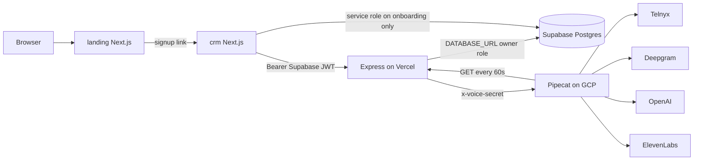
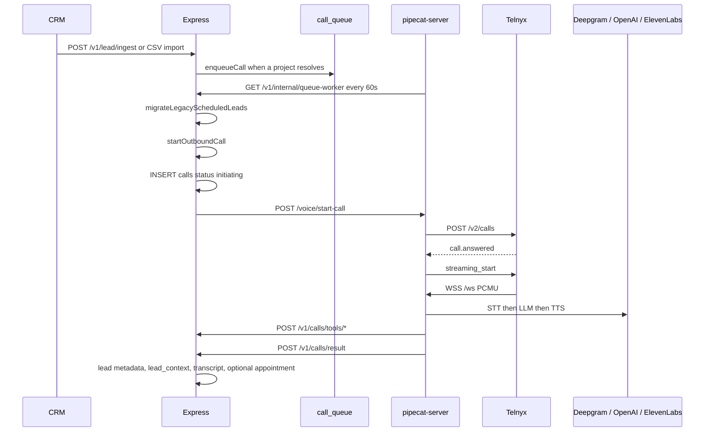

# CURRENT_ARCHITECTURE.md

# Current architecture

**Verified:** 10 November 2026, read-only.  
**Sources:** this workspace, the connected Supabase project, and the connected Vercel team.  
**Not verified:** whether the GCP voice process is running at this moment, DNS records beyond Vercel domain objects, backups, and provider account health.

This workspace is one folder with four applications. It is not an npm workspace. There is no root `package.json`, no root README, and no `.github` workflow.

| Directory | Role | Runtime | Deploy target (verified) |
|---|---|---|---|
| `landing/` | Marketing site | Next.js 15, React 19, Tailwind 4 | Vercel project `landing`. Production domains `www.cortexflow.in` and `cortexflow.in` (apex redirects to www). Also `landing-mu-wine.vercel.app`. No environment variables on the project. |
| `crm/` | Product UI | Next.js 15, React 18, Tailwind 3, TypeScript 5 | Vercel project `crm`. Production domain `crm.cortexflow.in` (verified). Also `crm-sage-xi.vercel.app`. |
| `backend/` | API | Node, Express 4.18, `pg` 8.18 | Vercel project `cortex-backend-api`. Domain `cortex-backend-api.vercel.app`. `backend/vercel.json` builds `server.js` with `@vercel/node`. |
| `pipecat-server/` | Voice runtime | Python, FastAPI, Pipecat 0.0.108 | Not a Vercel project. Intended host is a GCP VM. Production `VOICE_SERVICE_URL` is set on the backend project. The VM process itself was not inspected over SSH. |
| `DOCS/` | Markdown | — | Not deployed |

Git deploys for CRM and API come from GitHub `nar0ttamm/cortex_full`, branch `main`. The newest READY production deployment of both, at audit time, is commit `cc15cd7b6d3b997380a4d7cb34b0979013ce47da`.

## How a request moves



`landing/app/lib/site.ts` points signup at `https://crm.cortexflow.in/signup`. The marketing app does not create users.

`crm/lib/supabase-client.ts` is a backend HTTP client. The name is historical. Lead reads and writes go to Express, not to PostgREST.

Express connects with `pg` in `backend/db.js`: `max: 1`, `ssl.rejectUnauthorized: false`. That connection uses `DATABASE_URL`. In Supabase this is the database owner, which bypasses row level security because `FORCE ROW LEVEL SECURITY` is off on every public table.

## Background work

| Job | Where it actually runs | Schedule in code | Schedule on Vercel |
|---|---|---|---|
| Queue worker `runQueueWorker` | Voice VM calls `GET /v1/internal/queue-worker` from `_queue_poller` in `pipecat-server/server.py` | every 60 seconds | `backend/vercel.json` cron is `0 0 * * *` (once a day) for `/v1/internal/queue-worker` |
| Same function again | `GET/POST /v1/internal/process-pending-calls` | same handler | not in `vercel.json` |
| Appointment reminders `runReminderJob` | Same poller also calls `/v1/internal/process-reminders` every 60 seconds | local `node-cron` in `backend/jobs/index.js` is hourly, and only when `node server.js` is the main module | Vercel cron is daily |
| `backend/jobs/callScheduler.js` | Not started by `jobs/index.js` | — | Dead relative to the current boot path |

`startJobs()` in `backend/jobs/index.js` runs only under `require.main === module`. Vercel imports `server.js` as a module, so the Node cron does not run in production. Production dialing depends on the Python poller.

## External services that the code calls

| Service | Called from | Purpose |
|---|---|---|
| Supabase Auth | `backend/middleware/auth.js`, CRM middleware | JWT validation, signup, login |
| Supabase Postgres | `backend/db.js` | All application data |
| Telnyx Call Control | `pipecat-server/server.py` | Outbound dial and media |
| Deepgram | `pipecat-server/bot.py` | STT |
| OpenAI | `bot.py` and `backend/config` fallback | Conversation LLM and post-call summary |
| ElevenLabs | `bot.py` | TTS |
| Resend | `backend/services/notificationService.js` | Email |
| AiSensy | same file | WhatsApp template campaigns |
| Google OAuth / Calendar | `backend/routes/googleCalendar.js` | Calendar tokens and events |
| Meta Graph | `backend/routes/metaIntegration.js` | Lead Ads OAuth and leadgen |

Not present in code: Stripe, Google Ads API, LiveKit, FreeSWITCH, n8n, Twilio, pgvector.

`livekit-server-sdk` is listed in `backend/package.json` and is not imported.

# DATABASE_SCHEMA_REFERENCE.md

# Database schema reference

**Verified against the live Supabase project on 10 November 2026.**  
The repo does not contain this schema. `backend/migrations/` has one file, `20260920_lead_context_conversion.sql`, which only adds conversion columns to `lead_context`.

Supabase migration history on the database (names only):

| Version | Name |
|---|---|
| 20260311082153 | create_calls_and_transcripts |
| 20260311082210 | create_integrations_tables |
| 20260427224235 | v2_user_profiles_and_teams |
| 20260427224257 | v2_knowledge_base_and_demo |
| 20260505182148 | v3_calling_stack_upgrade |
| 20260622032619 | cascade_lead_call_child_fks |
| 20260622032701 | standardize_timestamptz |
| 20260622032717 | create_communications_table |
| 20260920142640 | enable_rls_all_public_tables |
| 20260920172144 | lead_context_conversion |

Those migration SQL bodies were not re-read. The catalog below is the live result of `information_schema` and `pg_catalog`, not a reconstruction from the migration names.

## Platform objects

- Extensions: `plpgsql`, `pgcrypto` 1.3, `uuid-ossp` 1.1, `pg_stat_statements` 1.11, `supabase_vault` 0.3.1. No `vector`.
- Public views and materialized views: none.
- Public functions and stored procedures: none.
- Public triggers: none.
- Storage buckets: none.
- RLS: enabled on all 24 `public` tables. `relforcerowsecurity` is false on all of them. `pg_policies` returned no rows. Supabase advisor `rls_enabled_no_policy` lists all 24.
- Grants: `anon`, `authenticated`, and `service_role` each have `SELECT`, `INSERT`, `UPDATE`, `DELETE`, `TRUNCATE`, `REFERENCES`, and `TRIGGER` on all 24 public tables. With RLS on and no policies, `anon` and `authenticated` are denied by default. `service_role` and the table owner bypass RLS.

Columns not listed under "NOT NULL or default" in the catalog query are nullable and have no default. Types below are `udt_name`.

## tenants

Company workspace. Approx. 6 rows.

| Column | Type | Notes |
|---|---|---|
| id | uuid | PK, default `gen_random_uuid()`. Signup sets this to the auth user id |
| name | varchar | NOT NULL |
| slug | varchar | NOT NULL, UNIQUE |
| status | varchar | default `active` |
| settings | jsonb | default `{}` |
| created_at | timestamptz | default `now()` |
| onboarding_completed | bool | default false |
| plan | varchar | default `starter`. CHECK in (`starter`,`growth`,`enterprise`) |
| trial_ends_at | timestamptz | nullable, no DB enforcement |
| industry | varchar | |
| address | text | |
| gstin | varchar | |
| admin_user_id | uuid | no FK found |

Indexes: `tenants_pkey`, `tenants_slug_key`, `idx_tenants_slug`, `idx_tenants_status`.

## user_profiles

| Column | Type | Notes |
|---|---|---|
| id | uuid | PK |
| user_id | uuid | NOT NULL, UNIQUE. Supabase auth user. No FK into `auth.users` was returned |
| tenant_id | uuid | FK → `tenants.id` |
| full_name | varchar | |
| phone | varchar | |
| role | varchar | NOT NULL, default `executive`. CHECK in (`admin`,`manager`,`executive`) |
| position | varchar | |
| is_active | bool | default true |
| created_at, updated_at | timestamptz | default `now()` on created |

Indexes: pkey, `user_profiles_user_id_key`, `idx_user_profiles_tenant_id`.

## teams / team_members

`teams`: id PK, tenant_id NOT NULL FK, name NOT NULL, manager_id FK → `user_profiles.id`, description, timestamps.  
`team_members`: id PK, team_id NOT NULL FK, user_profile_id NOT NULL FK, role NOT NULL default `executive` CHECK in (`manager`,`executive`), joined_at. UNIQUE `(team_id, user_profile_id)`. No `tenant_id` column. Approx. 3 teams, 1 member.

## projects

id PK, tenant_id NOT NULL FK, team_id FK, created_by FK → `user_profiles.id`, name NOT NULL, description, status default `active` CHECK in (`active`,`paused`,`archived`), lead_source, settings jsonb default `{}`, timestamps. Index `idx_projects_tenant_id`. Approx. 3 rows. Used by dial and CRM.

## leads

id PK, tenant_id NOT NULL FK, name NOT NULL, phone NOT NULL, email, inquiry, source, status default `new` (no CHECK), metadata jsonb default `{}`, timestamps, project_id FK, assigned_to FK → `user_profiles.id`. UNIQUE `(tenant_id, phone)`. Indexes on phone, project, `(tenant_id, status)`, created_at. Approx. 18 rows.

Notes, status history, and a communications log also live inside `metadata` (`notes`, `status_history`, `communications_log`). That duplicates the `communications` table.

## lead_context

One row per lead. UNIQUE `lead_id`. FK to leads, tenants, projects. Columns: budget, preferred_location, property_type, timeline, possession_preference, interest_level, objections jsonb default `[]`, callback_time, appointment_interest default false, last_summary, last_outcome, last_contacted_at, previous_interest_level, call_count NOT NULL default 0, timestamps, score, temperature, next_action, next_action_at, human_handoff default false, ai_confidence, score_signals jsonb default `[]`, preferred_product, decision_maker. Approx. 7 rows. Written by `leadIntentExtractor.js` and `newCalls.js`.

## call_queue

id PK, tenant_id NOT NULL, project_id FK, lead_id NOT NULL FK, priority NOT NULL default 5, scheduled_at NOT NULL default now(), status NOT NULL default `queued` (**no CHECK**), attempt_count NOT NULL default 0, last_attempt_at, failure_reason, call_id FK → calls, timestamps. Indexes: `(tenant_id, status, scheduled_at)`, partial index where status in (`queued`,`retry_scheduled`), index on lead_id. Approx. 118,241 rows: 118,239 `failed`, 2 `retry_scheduled`.

## calls

id PK, tenant_id NOT NULL, lead_id NOT NULL, phone NOT NULL, status NOT NULL default `initiating` (no CHECK), outcome, duration_seconds, error_message, started_at, ended_at, timestamps, project_id FK. No Telnyx `call_control_id` column. Exact counts: 118,255 `failed`, 11 `completed`, 1 `initiating`. Failed message is almost entirely `HTTP 502`. Indexes on tenant, lead, project, status, created_at.

## call_transcripts

id PK, call_id NOT NULL UNIQUE FK → calls, full_transcript, summary, created_at NOT NULL. **No tenant_id.** Approx. 11 rows.

## call_events

id PK, call_id NOT NULL FK, event_type NOT NULL, event_data jsonb, created_at NOT NULL. **No tenant_id.** Approx. 11 rows.

## call_analytics

id PK, call_id FK, tenant_id NOT NULL, project_id FK, lead_id FK, ring/talk durations, tool_call_count, barge_in_count, silence_count, filler_phrase_count, pickup_confirmed, appointment_booked, callback_scheduled, outcome, retry_count, failure_reason, call_brief_version default `v3`, created_at NOT NULL. Approx. 4 rows.

## appointments

id PK, tenant_id NOT NULL, lead_id FK, project_id FK, call_id FK, scheduled_at NOT NULL, title, notes, status default `scheduled` CHECK in (`scheduled`,`completed`,`cancelled`,`rescheduled`), google_event_id, google_meet_link, reminder flags default false, timestamps. **0 rows.** Reminder job does not read this table. It reads `leads.metadata`.

## communications

id PK, tenant_id NOT NULL, lead_id FK, channel NOT NULL, direction NOT NULL, subject, message, status, provider, metadata jsonb NOT NULL default `{}`, created_at NOT NULL. Approx. 120 rows. Parallel log also exists in `leads.metadata.communications_log`.

## credentials

id PK, tenant_id NOT NULL FK, service NOT NULL, encrypted_data NOT NULL, is_active default true, created_at. UNIQUE `(tenant_id, service)`. **0 rows.** AES payload is produced by `backend/encryption.js`.

## knowledge_bases / kb_products

`knowledge_bases`: id, tenant_id NOT NULL, project_id FK, type NOT NULL default `tenant` CHECK in (`tenant`,`project`), title, brand_voice, calling_rules, company_instructions, custom_content jsonb, timestamps. **0 rows.** Read by `callContextBuilder.js` when present.

`kb_products`: id, project_id NOT NULL, tenant_id NOT NULL, name NOT NULL, property_type, location, price_range, size, possession_status, amenities, extra_details jsonb, is_active default true, timestamps. Approx. 3 rows. This is the catalog the voice agent searches.

## integrations / integration_sources / integration_logs

`integration_sources` is global: id, key UNIQUE, label, integration_type default `webhook`, description, is_active, created_at. Live keys: generic, google_lead_forms, indiamart, justdial, meta_lead_ads, tally, typeform, zapier.

`integrations`: per tenant, UNIQUE `(tenant_id, integration_key)`. webhook_secret and encrypted_credentials are nullable text. webhook_secret is not encrypted. Approx. 1 row.

`integration_logs`: payload jsonb, lead_id FK, error_message. Approx. 3 rows.

## google_calendar_tokens

UNIQUE `tenant_id`. access_token NOT NULL, refresh_token nullable, both plaintext. **0 rows.**

## tenant_usage

UNIQUE `(tenant_id, month)`. Counters all NOT NULL default 0: calls_attempted, calls_connected, call_minutes_used numeric, demo_calls_used, failed_calls, no_answer_calls, ai token estimates, whatsapp_messages_sent, emails_sent, appointments_booked, callbacks_scheduled. Approx. 9 rows. `usageTracker.js` increments them. Nothing reads them to refuse work.

## activity_logs

id, tenant_id FK, project_id FK, user_id (no FK), action_type NOT NULL, entity_type, entity_id, metadata default `{}`, created_at. Approx. 8 rows.

## demo_requests

No tenant_id. name, whatsapp_number NOT NULL, status default `pending` CHECK in (`pending`,`calling`,`completed`,`failed`), flags, error_log, ip_address. Approx. 3 rows.

## Use classification

| Table | Use |
|---|---|
| tenants, user_profiles, leads, projects, calls, call_queue, lead_context, kb_products, tenant_usage, communications, integration_sources | Used by current code and have or had rows |
| teams, team_members, integrations, integration_logs, activity_logs, call_transcripts, call_events, call_analytics, demo_requests | Used by current code, thin data |
| appointments, credentials, knowledge_bases, google_calendar_tokens | Written by current code paths, zero rows |
| None of the 24 are an abandoned duplicate table | `communications` and `leads.metadata.communications_log` are two stores for the same idea. `appointments.reminder_*` and `leads.metadata.reminder_*` are two reminder models. The job uses metadata |

No table should be dropped because the frontend rarely mentions it. `call_events` and `call_analytics` are written from the voice path.

# API_REFERENCE.md

# API reference

Base URL in production is the Vercel project `cortex-backend-api` at `https://cortex-backend-api.vercel.app`. Routes are mounted in `backend/server.js`.

Auth words:

- **JWT** — `requireUser` in `backend/middleware/auth.js`. Supabase `GET /auth/v1/user`, then `user_profiles`. A claimed `tenant_id` must match.
- **Voice** — header `x-voice-secret` equals `VOICE_SECRET`.
- **Cron** — bearer `CRON_SECRET`, or the voice secret.
- **Admin** — header `x-admin-token` or bearer equals `ADMIN_TOKEN`.
- **Public** — `isPublicPath` skips JWT. Some public routes then check a secret. Some do not.

Request and response bodies are JSON unless noted. Errors use `{ error: string }` from the global handler, which returns `err.message`.

## Session and health

| Method | Path | Auth | Behavior | File |
|---|---|---|---|---|
| GET | `/health` | Public | `SELECT 1`. 200 `{status, database}` or 500 with `error` | `server.js` |
| GET | `/v1/me` | JWT | `{userId, email, tenantId, role}` | `server.js` |

## Leads — `backend/routes/leads.js`

| Method | Path | Auth | Behavior |
|---|---|---|---|
| POST | `/v1/lead/ingest` | JWT | Requires tenant_id, name, phone. Dedupe on `(tenant_id, phone)`. Resolves project. Inserts lead. Enqueues unless project is unresolved. Fires notifications. |
| GET | `/v1/leads/:tenantId` | JWT | List for the session tenant. Joins `lead_context` score fields. |
| GET | `/v1/leads/:tenantId/:leadId` | JWT | One lead. |
| GET | `/v1/leads/by-phone/:tenantId/:phone` | JWT | Lookup. Declared after `/:leadId`, so Express can treat `by-phone` as a tenant id. Do not add clients on this path until the order is fixed. |
| PATCH | `/v1/leads/:leadId` | JWT | status, metadata, project_id, assigned_to. Tenant from the session. |
| POST | `/v1/lead/status` | JWT | Status change plus history inside metadata. |
| POST | `/v1/leads/:leadId/notes` | JWT | Appends `{id, text, ...}` onto `metadata.notes`. |
| DELETE | `/v1/leads/:leadId/notes/:noteId` | JWT | Removes one note from that array. |
| POST | `/v1/lead/metadata` | JWT | Metadata merge. |
| GET | `/v1/analytics/conversion` | JWT | Aggregates from `conversionAnalytics.js`. |

## Calls — `backend/routes/newCalls.js` and `calls.js`

| Method | Path | Auth | Behavior |
|---|---|---|---|
| POST | `/v1/calls/start` | JWT, in-memory 20/min | `startOutboundCall`. |
| POST | `/v1/calls/result` | Public + voice | Idempotent result. Updates lead, transcript, score, queue, optional appointment. |
| GET | `/v1/calls/:tenantId/summary` | JWT | `COUNT(*)` of the tenant's calls, plus active count. |
| GET | `/v1/calls/:tenantId` | JWT | List joined to transcripts. `limit` query is not capped. |
| POST | `/v1/call/event` | JWT | Legacy event insert into `call_events`. |
| POST | `/v1/call/simulate` | JWT | Legacy simulator. Still mounted. |

## Voice tools — `backend/routes/callTools.js`

| Method | Path | Auth | Behavior |
|---|---|---|---|
| POST | `/v1/calls/tools/search-products` | Public prefix + voice | `productSelector` / `kb_products`. |
| GET | `/v1/calls/tools/product/:productId` | Voice | One active product, tenant and project checked. |
| POST | `/v1/calls/tools/update-lead-memory` | Voice | Writes `lead_context`. |
| POST | `/v1/calls/tools/log-analytics` | Voice | Inserts `call_analytics`. |
| GET | `/v1/calls/analytics` | JWT | Read analytics. |
| GET | `/v1/calls/usage/:tenantId` | JWT | `tenant_usage`. |

## Voice process — `pipecat-server/server.py`

| Method | Path | Auth | Behavior |
|---|---|---|---|
| POST | `/voice/start-call` | `x-voice-secret`, else 503 | Capacity check, Telnyx dial. 502 if Telnyx throws. |
| POST | `/telnyx-webhook` | Ed25519 if `TELNYX_PUBLIC_KEY` is set. If the key is missing, verification returns true. `TELNYX_WEBHOOK_ENFORCE=false` accepts bad signatures. | `call.answered` starts media. |
| WS | `/ws` | No shared secret | Telnyx media. Bot handshake can return without starting a model. |
| GET | `/health` | Public | Booleans for which env vars are non-empty, plus the configured caller ID and domain. |

## Internal — `backend/routes/internal.js`

| Method | Path | Auth | Behavior |
|---|---|---|---|
| GET, POST | `/v1/internal/queue-worker` | Cron | `runQueueWorker` |
| GET, POST | `/v1/internal/process-pending-calls` | Cron | Same function |
| GET, POST | `/v1/internal/process-reminders` | Cron | `runReminderJob` |

## Appointments — `backend/routes/appointments.js`

| Method | Path | Auth | Behavior |
|---|---|---|---|
| POST | `/v1/appointment/schedule` | JWT | Insert appointment and lead metadata. |
| POST | `/v1/appointment/update` | JWT | Status / time update. |
| GET | `/v1/appointments/:tenantId` | JWT | List. |

## Credentials and tenant — `backend/routes/credentials.js`, `admin.js`

| Method | Path | Auth | Behavior |
|---|---|---|---|
| GET | `/v1/credentials/:tenantId/:service` | JWT, any role | Returns **decrypted** credential JSON. |
| POST | `/v1/admin/credentials` | Admin | Encrypt and upsert. |
| DELETE | `/v1/admin/credentials/:tenantId/:service` | Admin | Delete row. |
| POST | `/v1/admin/tenant` | Admin | Create tenant by name and slug. |
| GET | `/v1/tenant/:tenantId` | JWT, any role | Read tenant. |
| PATCH | `/v1/tenant/:tenantId` | JWT, any role | Update name and settings JSON. |

## Projects, teams, users

`backend/routes/projects.js`: GET/POST `/v1/projects`, GET/PATCH `/v1/projects/:id`, GET/POST/PATCH `/v1/teams`, members GET/POST/DELETE. Team writes check `req.role` in `admin` or `manager`.

`backend/routes/users.js`: GET `/v1/users`, GET `/v1/users/me`, POST `/v1/users/create` (admin or manager, Supabase admin API), PATCH `/v1/users/:userId`.

`backend/routes/knowledgeBase.js`: GET/POST `/v1/kb`, PATCH `/v1/kb/:id`, GET/POST `/v1/kb/products`, PATCH/DELETE `/v1/kb/products/:id`.

`backend/routes/activityLogs.js`: GET/POST `/v1/activity`.

`backend/routes/notifications.js`: POST `/v1/notifications/send`.

## Webhooks and OAuth

| Method | Path | Auth | Behavior | File |
|---|---|---|---|---|
| POST | `/v1/webhook/:tenantId/:integrationKey` | Public. HMAC or bearer if `webhook_secret` is set. **Null secret is allow.** | Normalize and ingest | `integrations.js` |
| GET | `/v1/webhook/:tenantId/:integrationKey` | Public. Echoes `hub.challenge` with **no verify token** | Challenge | same |
| GET | `/v1/integrations/supported` | JWT | Catalog | same |
| GET, POST, DELETE | `/v1/integrations/:tenantId...` | JWT | CRUD, regenerate secret, logs, test | same |
| GET | `/v1/meta/auth` | JWT | OAuth start | `metaIntegration.js` |
| GET | `/v1/meta/callback` | Public prefix | OAuth return | same |
| GET | `/v1/meta/webhook` | Public. Compares `META_WEBHOOK_VERIFY_TOKEN` | Meta subscribe | same |
| POST | `/v1/meta/webhook` | Public. **No X-Hub-Signature.** Responds 200 first | Leadgen | same |
| GET, DELETE | `/v1/meta/status`, `/v1/meta/disconnect` | JWT | | same |
| GET | `/v1/google-calendar/auth` | JWT | OAuth start | `googleCalendar.js` |
| GET | `/v1/google-calendar/callback` | Public prefix | Stores tokens | same |
| GET, POST, DELETE | status, create-event, disconnect | JWT | Calendar | same |
| GET, POST | `/v1/email/inbound` | Public. No Resend signature | Attaches reply to the latest lead with that email, any tenant. Response includes lead name | `email.js` |
| POST | `/v1/demo/request` | Public. In-memory 5/hour/IP | Creates a demo lead and dials | `demo.js` |
| POST | `/v1/demo/whatsapp-interaction` | Public | Demo flag update | `demo.js` |

## CRM route handlers

These live in `crm/app/api/` and are a second surface. Middleware does not protect `/api`.

| Path | Behavior | File |
|---|---|---|
| POST `/api/onboarding/complete` | Service role upsert of tenant, profile, default team | `onboarding/complete/route.ts` |
| POST `/api/import` | CSV parse, then `POST /v1/lead/ingest` per row | `import/route.ts` |
| GET `/api/me` | Session | `me/route.ts` |
| GET `/api/stats` | Stats helper | `stats/route.ts` |
| GET `/api/activity` | Activity proxy | `activity/route.ts` |
| GET `/api/crm-data` | CRM bundle | `crm-data/route.ts` |
| `/api/leads/[leadId]` and notes | Proxies to Express with the user token | lead route files |
| POST `/api/auth/logout` | Supabase sign-out | `auth/logout/route.ts` |
| GET `/api/auth/callback` | `exchangeCodeForSession` | `auth/callback/route.ts` |

No Google Ads route exists. Google Lead Forms is only a row in `integration_sources`.

# FEATURE_STATUS_MATRIX.md

# Feature status matrix

Status meanings:

1. **Implemented and verified** — code path exists and a test was executed, or production data shows the write.
2. **Implemented but unverified** — code path exists. This audit did not click it or call the provider.
3. **Partially implemented** — UI or API exists and an important half is missing or empty in production.
4. **Not implemented** — no code path.
5. **Obsolete** — still in the tree, not on the current boot path, or describes a replaced system.

"Verified" here does not mean a browser session was run. The CRM UI was not clicked.

| Feature | Status | Where | Evidence |
|---|---|---|---|
| Marketing homepage, pricing anchors, FAQ | 2 | `landing/app/page.tsx` | Vercel domain `www.cortexflow.in` is verified. Page content was not rendered in a browser |
| Signup and login | 2 | `crm/app/signup/page.tsx`, `login/page.tsx`, `middleware.ts` | Supabase auth plus onboarding route. Live DB has user profiles |
| Tenant creation | 2 | `crm/app/api/onboarding/complete/route.ts` | Tenant id = auth user id. Live tenants exist |
| Default team on signup | 2 | same file | `teams` has rows |
| Dashboard charts | 2 | `crm/app/page.tsx`, `DashboardAnalyticsCharts.tsx` | Client-side from leads already loaded |
| Dashboard CSV/PNG export | 2 | `exportCsv` in that component | Export of in-memory rows, not a server report |
| Lead list and detail | 2 | `crm/app/leads/page.tsx`, `[id]/page.tsx` | API list/detail. About 18 leads in the DB |
| Lead search and status/source filters | 2 | `filterLeads` in `leads/page.tsx` | Filters the already-fetched array. No server search |
| Kanban of lead statuses | 3 | same page, `viewMode === 'kanban'` | Fixed columns in the component. No per-tenant column config |
| Lead statuses | 3 | varchar default `new`, no CHECK | Values used in code: new, contacted, interested, qualified, not_interested, closed. Not a workflow engine |
| Lead assignment | 3 | `leads.assigned_to`, PATCH | Column and API exist. No round-robin. Team scope does not filter the list |
| Human handoff banner | 2 | `LeadConversionPanel.tsx`, `lead_context.human_handoff` | Flag from `leadScore.js`. No call transfer |
| Lead notes | 2 | `POST/DELETE /v1/leads/:id/notes` | Stored in `leads.metadata.notes`, not a table |
| Activity history | 3 | `activity_logs` and metadata status history | About 8 activity rows. Not a full audit log |
| CSV import | 2 | `crm/app/data/page.tsx`, `crm/app/api/import/route.ts` | Naive `split(',')`. Quoted commas will break |
| CSV export of leads | 2 | `handleExport` on the data page | Client download of loaded leads |
| Projects wizard | 2 | `crm/app/projects/page.tsx`, `ProjectWizard.tsx`, `routes/projects.js` | 3 project rows |
| Knowledge products | 3 | `kb_products`, `routes/knowledgeBase.js` | 3 product rows. `knowledge_bases` has 0 |
| Teams and user invite | 2 | `crm/app/team/page.tsx`, `routes/users.js`, `routes/projects.js` | Role check on create. 1 team member row |
| Usage counters | 2 | `crm/app/usage/page.tsx`, `usageTracker.js` | Page text says the numbers are not a plan limit |
| Plan selection at signup | 3 | signup plan cards, `tenants.plan` CHECK | Stored. Never enforced. No Stripe |
| Trial end | 3 | `trial_ends_at` set to now+3 days | No reader blocks login or dialing |
| Tenant settings | 2 | `crm/app/tenant/page.tsx`, `PATCH /v1/tenant/:id` | Any member can patch |
| Pipeline page | 3 | `crm/app/pipeline/page.tsx` | File exists. Sidebar `NAV` does not link it |
| Analytics page | 3 | `crm/app/analytics/page.tsx` | Same. Charts that users see are on `/` |
| Communications UI | 2 | `crm/app/communications/page.tsx` | `communications` has about 120 rows |
| WhatsApp send | 3 | `notificationService.sendWhatsApp` | AiSensy. `credentials` has 0 rows. Skips if unset |
| Email send | 3 | `sendEmail` via Resend | Per-tenant credentials empty. Global `RESEND_API_KEY` exists on the **CRM** Vercel project. Backend send path reads backend env. Whether the backend project has `RESEND_API_KEY` was not in the env name list returned for `cortex-backend-api` |
| Appointments UI | 3 | `crm/app/appointments/page.tsx`, `routes/appointments.js` | Table has 0 rows |
| Appointment from a call | 3 | `appointmentFromCall.js` | Code inserts a row. Table is empty. 3 historical `calls.outcome = appointment_booked` did not leave rows |
| Google Calendar | 3 | `routes/googleCalendar.js` | 0 token rows |
| Reminders | 3 | `jobs/reminderJob.js` | Reads lead metadata, not `appointments`. Needs AiSensy |
| Integrations hub | 2 | `crm/app/integrations/page.tsx`, `routes/integrations.js` | Catalog of 8 webhook sources. 1 integration row |
| Meta Lead Ads | 3 | `routes/metaIntegration.js` | OAuth and webhook exist. POST signature is not checked |
| Google Lead Forms | 3 | webhook catalog key `google_lead_forms` | Generic webhook, not the Google Ads API |
| Outbound AI call | 3 | `startOutboundCall.js`, `pipecat-server/` | 11 completed calls, last 7 June 2026. Current rows are HTTP 502 |
| Call history UI | 2 | `crm/app/calls/page.tsx` | Reads `calls`. Will include the failed mass |
| Scoring and next action | 1 | `leadScore.js`, `nextAction.js`, `backend/tests/conversion.test.js` | 18 tests passed on 10 November 2026 |
| Callback time parse | 1 | `callbackSchedule.js` | Covered by those tests |
| Project auto-assign | 1 | `projectResolver.js` | Covered by those tests |
| Consent / opt-out | 4 | — | No column, no check |
| Call forwarding / transfer | 4 | — | No Telnyx transfer action |
| Live agent handoff UI | 4 | — | Banner only |
| Subscriptions and bundles | 4 | — | No billing table, no Stripe |
| Kanban configuration | 4 | — | Status columns are hardcoded |
| Document knowledge base | 4 | — | No upload, no embeddings |
| Inbound calling | 4 | — | Outbound Call Control only |
| Tasks | 4 | — | No table |
| `callScheduler.js` | 5 | `backend/jobs/callScheduler.js` | Not started by `jobs/index.js` |
| `POST /v1/call/simulate` | 5 | `routes/calls.js` | Still mounted |
| LiveKit / FreeSWITCH docs | 5 | `DOCS/PRODUCT.md`, `TECHNICAL_MANUAL.md`, `AI_CONTEXT.md` | Code header in `server.py` says that stack was replaced |
| Google Sheets dual-write | 5 | CRM env names `GOOGLE_SHEET_ID`, `NEXT_PUBLIC_ENABLE_DUAL_WRITE`, `NEXT_PUBLIC_USE_SUPABASE_PRIMARY` | No references in `*.js` / `*.ts` / `*.tsx`. `crm/lib/data-source.ts` says Sheets were removed |

## Where new UI should attach

Do not add a parallel app. Extend these files:

| Future feature | Attach to |
|---|---|
| Kanban configuration | `crm/app/leads/page.tsx` column list, backed by `tenants.settings` or `projects.settings` jsonb. Status writes already use `PATCH /v1/leads/:leadId` |
| Lead assignment | Lead detail and the existing `assigned_to` PATCH. Team page already lists users via `/v1/users` |
| Notes and timeline | Lead detail. Notes API exists. Activity is `GET /v1/activity` plus metadata history. Prefer one timeline component over a new store |
| Calendar | `crm/app/appointments/page.tsx` and `/v1/appointments/:tenantId`. Google sync already has routes. Token storage must be encrypted before it is turned on |
| Integrations hub | `crm/app/integrations/page.tsx` and `/v1/integrations/:tenantId` |
| Usage | `crm/app/usage/page.tsx` and `/v1/calls/usage/:tenantId`. Enforcement belongs in `startOutboundCall` and `usageTracker.js`, not in a new page |
| Subscriptions | New server checks next to `tenants.plan`. There is no UI to extend except the signup plan step and the usage page. Do not invent a second billing app |
| Call forwarding settings | `crm/app/tenant/page.tsx` settings JSON, only after a Telnyx transfer action exists. It does not |
| Agent handoff | `LeadConversionPanel.tsx` already shows the flag. A transfer control would call a new backend route. There is no route to reuse |

# VOICE_PIPELINE_AUDIT.md

# Voice pipeline audit

**No calls were placed during this audit.**

## Lifecycle that the code implements



| Step | Function | File |
|---|---|---|
| Insert queue row | `enqueueCall` | `backend/services/callQueueService.js` |
| Also insert from ingest | `POST /lead/ingest` | `backend/routes/leads.js` |
| Also insert from webhooks | `processWebhookPayload` | `backend/integrations/webhookHandler.js` |
| Re-insert legacy leads | `migrateLegacyScheduledLeads` | `backend/routes/internal.js` |
| Pick work | `runQueueWorker` | same |
| Daily cap helper | `canAttemptLead` | `callQueueService.js` |
| Dial | `startOutboundCall` | `backend/services/startOutboundCall.js` |
| Telnyx | `_make_telnyx_call` | `pipecat-server/server.py` |
| Media and model | `bot` | `pipecat-server/bot.py` |
| Persist result | `POST /calls/result` | `backend/routes/newCalls.js` |

## Queue states the code writes

There is no CHECK constraint on `call_queue.status`. Writers use:

`queued` → `processing` (inside the lock) → `calling` (after the VM accepts) or `failed` or `retry_scheduled` or `max_attempts_reached`.

`getQueuedCalls` only selects `queued` and `retry_scheduled` whose `scheduled_at <= now()`.

`canAttemptLead` counts rows for the lead where `last_attempt_at` is today and status is not `queued`, `cancelled`, or `retry_scheduled`. Cap is `MAX_ATTEMPTS_PER_DAY = 2`.

`updateQueueStatus` sets `last_attempt_at` only when the new status is `calling` or `processing`. The worker's own lock update sets `processing` with a raw `UPDATE` that does **not** set `last_attempt_at`. A later update to `failed` also does not set it.

## Polling

- VM: `_queue_poller` sleeps 60 seconds, then GET queue-worker and GET process-reminders. Auth header is `CRON_SECRET` or `VOICE_SECRET`.
- Worker capacity: `MAX_CONCURRENT_CALLS` default 3 in Node, default 4 in Python. They are separate env vars.
- Vercel cron in `backend/vercel.json` is daily, not minutely. It is not the clock that created the failure volume.
- Locking: `SELECT ... FOR UPDATE SKIP LOCKED` on the queue row, then status `processing`, then commit, then dial outside the transaction.

## Provider ids

Telnyx `call_control_id` is kept in the VM dict `_pending_calls` and in the websocket query body. It is **not** written to `calls`. After a restart the VM cannot correlate a webhook to a CRM call except by what is still in memory. `calls.id` is a UUID generated in `startOutboundCall` and sent as `call_id`.

## What the database shows

| Status | calls | call_queue |
|---|---|---|
| failed | 118,255 | 118,239 |
| completed | 11, last on 7 June 2026 | — |
| initiating | 1 | — |
| retry_scheduled | — | 2 |

118,240 failed calls have `error_message = HTTP 502`. Queue `failure_reason` is `Voice service error`. FastAPI raises `HTTPException(502, detail=...)`. Express reads `body.error`, which FastAPI does not set, so the Telnyx text is discarded. The table cannot prove whether Telnyx was contacted.

From 27 October through 8 November 2026 about 2,300–2,400 call rows were inserted per day. 9 November: 340. 10 November: 2.

## Exact source of the repeat

All three of these are true in the current source:

1. `startOutboundCall` sets `metadata.call_initiated = true` only after the VM returns HTTP 200. On failure it sets `ai_call_status` to `Failed` and leaves `call_initiated` false.
2. `migrateLegacyScheduledLeads` inserts a **new** `call_queue` row for every lead that still has `metadata.scheduled_call_at`, is not `not_interested` or `closed`, and has no queue row in `queued`, `retry_scheduled`, `processing`, or `calling`. A `failed` row does not block the insert.
3. `canAttemptLead` does not count those new rows, because `last_attempt_at` is still null when the attempt dies as `failed` before `calling`.

So each minute the poller creates another queue row, `startOutboundCall` inserts another `calls` row, the VM returns 502, and the lead stays eligible.

`scheduleRetry` (30 minutes) runs only when the error string matches `ECONNREFUSED`, `timeout`, `fetch failed`, `ETIMEDOUT`, or `Voice service timeout`. The message stored for this incident is `Voice service error`, which is the non-retriable branch. The storm is not that retry helper. It is the legacy migrator plus a failure that does not stick.

## Consent, opt-out, transfer

- No consent column and no check before `enqueueCall` or `startOutboundCall`.
- No opt-out or DNC flag.
- `human_handoff` on `lead_context` is a score flag. `LeadConversionPanel.tsx` displays it. There is no Telnyx transfer, no whisper, and no live-listen socket.
- Answering-machine detection is disabled in `_make_telnyx_call`.

## Safest remediation

Do this in order. Do not turn Telnyx acceptance on first.

1. Stop `_queue_poller` on the VM, or make `runQueueWorker` return immediately when an env kill switch is set. That stops new rows without a schema change.
2. Change `migrateLegacyScheduledLeads` so a lead is skipped when **any** `call_queue` row exists for that lead in a non-cancelled status, including `failed`. Better: stop calling the migrator once `call_queue` is the only scheduler. `callScheduler.js` is already off the boot path.
3. In `updateQueueStatus` and in the failure branch of `runQueueWorker`, set `last_attempt_at = now()` for `failed`.
4. In `startOutboundCall`'s `markCallFailed`, set `metadata.call_initiated` true or clear `scheduled_call_at`, so step 2 has a second brake.
5. Make `canAttemptLead` count `calls` rows for that lead since midnight, not only queue rows with `last_attempt_at`.
6. Only after that is deployed, archive the 118k failed rows. Do not delete them before a backup. They are evidence and they make `GET /v1/calls/:tenantId/summary` count a huge set.
7. Persist `call_control_id` on `calls` in a later change so a webhook can be reconciled. That is not required to stop the loop.

Do not add a second queue table. Do not replace Pipecat to fix this.

# INTEGRATIONS_REFERENCE.md

# Integrations reference

No provider was called. No secret value is recorded. "Configured on Vercel" means the **name** exists on that project. Values were not decrypted.

## Telnyx

| | |
|---|---|
| Files | `pipecat-server/server.py`, `pipecat-server/bot.py`, `pipecat-server/.env.example` |
| Auth | `TELNYX_API_KEY` bearer to `https://api.telnyx.com/v2/calls` |
| Other names | `TELNYX_PHONE_NUMBER`, `TELNYX_CC_APP_ID`, `TELNYX_PUBLIC_KEY`, `TELNYX_WEBHOOK_ENFORCE` |
| DB | No Telnyx id column. Attempt rows are `calls` and `call_queue` |
| Metering | `tenant_usage.calls_attempted` increments before the VM responds. Minutes increment only from a result with duration ≥ 10s |
| Webhook | `POST /telnyx-webhook` on the VM |
| Retry | VM does not retry a failed Telnyx POST. The backend queue can create another attempt. See `VOICE_PIPELINE_AUDIT.md` |
| Verified in production | 11 `calls.status = completed`, last 7 June 2026. Later rows are HTTP 502 from the voice HTTP call. Not proof of current origination |

## Deepgram

| | |
|---|---|
| Files | `pipecat-server/bot.py` |
| Auth | `DEEPGRAM_API_KEY` |
| Config | Default STT mode uses model `nova-3-general`, `language=multi`, 8 kHz, endpointing 100 ms. Optional `STT_MODE=flux` uses `flux-general-multi` |
| DB | None. `call_analytics` can store barge-in and silence counts if the bot posts them |
| Metering | None specific to Deepgram |
| Webhook | None. Streaming inside the websocket |
| Verified | Not by this audit. Implied only if a completed call used this file, which current `bot.py` does |

## OpenAI

| | |
|---|---|
| Files | `pipecat-server/bot.py` (`OpenAILLMService`), summary helper in the same file, `backend/config/index.js` |
| Auth | `OPENAI_API_KEY`. Also set on the **backend** Vercel project |
| Model name | `OPENAI_MODEL`, default `gpt-4o-mini` |
| DB | `tenant_usage.ai_input_tokens_estimated`, `ai_output_tokens_estimated` |
| Metering | Those counters. Not a hard cap |
| Verified | Key name exists on the backend. Live completion of a model call was not tested |

## ElevenLabs

| | |
|---|---|
| Files | `pipecat-server/bot.py` |
| Auth | `ELEVENLABS_API_KEY` |
| Names | `ELEVENLABS_VOICE_ID`, `ELEVENLABS_MODEL` default `eleven_turbo_v2_5` |
| DB | None |
| Metering | None |
| Verified | Not live-tested. Health endpoint reports whether the key looks non-empty. That endpoint was not requested |

## AiSensy (WhatsApp)

| | |
|---|---|
| Files | `backend/services/notificationService.js` |
| Auth | API key inside decrypted `credentials` service `aisensy`, or env `AISENSY_API_KEY` plus `AISENSY_CAMPAIGNS` |
| Endpoint | `POST https://backend.aisensy.com/campaign/t1/api/v2` |
| DB | `communications` log. `credentials` has 0 rows. `AISENSY_API_KEY` was **not** in the backend Vercel env name list returned for this audit |
| Webhook | None for delivery status |
| Retry | Send errors are logged and do not roll back the lead |
| Verified | Not as a live send. Code path is a skip when credentials are missing |

`DOCS/CORTEXFLOW_SYSTEM.md` and `DOCS/AI_CONTEXT.md` say Twilio. The notification service does not call Twilio.

## Resend (email)

| | |
|---|---|
| Files | `notificationService.js`, `backend/routes/email.js` |
| Auth | `credentials` service `resend` (`api_key`, `from_email`) or env `RESEND_API_KEY`, `RESEND_FROM_EMAIL` |
| Outbound | `POST https://api.resend.com/emails` |
| Inbound | `POST /v1/email/inbound`. No signature verification |
| DB | `communications`, and also `leads.metadata.communications_log` |
| Vercel | `RESEND_API_KEY` is set on the **CRM** project, which does not run `notificationService.js`. It was not in the backend env list |
| Verified | About 120 `communications` rows exist. This audit did not attribute them to Resend |

## Google Calendar

| | |
|---|---|
| Files | `backend/routes/googleCalendar.js` |
| Names on backend | `GOOGLE_CLIENT_ID`, `GOOGLE_CLIENT_SECRET`, `GOOGLE_REDIRECT_URI` |
| Same names also on the CRM project | Yes, plus `GOOGLE_SHEET_ID` |
| DB | `google_calendar_tokens`. Access and refresh tokens are plaintext columns. 0 rows |
| Webhook | OAuth callback `/v1/google-calendar/callback` is a public path |
| Verified | Not in production data |

`GOOGLE_SHEET_ID` has no reference in application source. Treat it as leftover.

## Meta Lead Ads

| | |
|---|---|
| Files | `backend/routes/metaIntegration.js` |
| Names | `META_APP_ID`, `META_APP_SECRET`, `META_WEBHOOK_VERIFY_TOKEN` |
| Present on backend Vercel | `META_WEBHOOK_VERIFY_TOKEN` only, in the list returned. App id and secret names were not in that list |
| DB | `integrations` row type `meta_page`, `encrypted_credentials`. Leads deduped by `metadata.meta_lead_id` |
| Webhooks | GET `/v1/meta/webhook` checks the verify token. POST does not check `X-Hub-Signature-256` |
| Verified | Not as a live leadgen delivery. One `integrations` row exists. Its type was not printed |

## Google Ads

Not implemented. `integration_sources.key = google_lead_forms` is a generic webhook label.

## Website forms and generic webhooks

| | |
|---|---|
| Files | `backend/routes/integrations.js`, `backend/integrations/webhookHandler.js`, `leadNormalizer.js` |
| URL | `POST /v1/webhook/:tenantId/:integrationKey` |
| Auth | `webhook_secret` via bearer or `sha256=` HMAC. Missing secret allows the request |
| Catalog keys in the DB | generic, google_lead_forms, indiamart, justdial, meta_lead_ads, tally, typeform, zapier |
| Retry | None. Duplicate phone returns `{status: duplicate}` |
| Verified | 3 `integration_logs` rows. Not re-read |

## Demo form

`POST /v1/demo/request` in `backend/routes/demo.js`. Public. Writes `demo_requests` and can dial the default tenant. Rate limit is an in-memory map.

## CRM env names that are not provider integrations

On Vercel project `crm`: `SUPABASE_SERVICE_ROLE_KEY`, `NEXT_PUBLIC_SUPABASE_URL`, `NEXT_PUBLIC_SUPABASE_ANON_KEY`, `NEXT_PUBLIC_API_URL`, `NEXT_PUBLIC_TENANT_ID`, `NEXT_PUBLIC_DEFAULT_TENANT_ID`, `NEXT_PUBLIC_USE_SUPABASE_PRIMARY`, `NEXT_PUBLIC_ENABLE_DUAL_WRITE`, `CRM_PASSWORD`, `RESEND_API_KEY`, Google names above.

`NEXT_PUBLIC_TENANT_ID` and `NEXT_PUBLIC_DEFAULT_TENANT_ID` are public by the Next.js prefix. Current tenant resolution in `crm/lib/auth.ts` uses `user_profiles`, not these variables. Confirm nothing else still reads them before treating them as harmless.

Landing Vercel project: no environment variables.

# SECURITY_AUDIT.md

# Security audit

Read-only. No exploit payloads were sent. No RLS policy was changed. No secret value is included.

## Tenant isolation

**Verified.** RLS is enabled on every `public` table and there are zero policies. `FORCE ROW LEVEL SECURITY` is off. `backend/db.js` connects with `DATABASE_URL`. That role is the table owner and bypasses RLS. The CRM onboarding route uses `SUPABASE_SERVICE_ROLE_KEY`, which also bypasses RLS.

`anon` and `authenticated` have `TRUNCATE` and full DML on all 24 tables. They are blocked only while RLS stays on and no permissive policy is added. The anon key is in the browser (`NEXT_PUBLIC_SUPABASE_ANON_KEY`).

Application filters are real on the routes that were read: lead and call queries include `tenant_id`, and `requireUser` rejects a mismatched claimed tenant. That is not the same as database enforcement. A missed `WHERE` is a cross-tenant read.

### Tables with `tenant_id`

tenants (the id itself), user_profiles, teams, projects, leads, lead_context, call_queue, calls, call_analytics, appointments, communications, credentials, knowledge_bases, kb_products, integrations, integration_logs, google_calendar_tokens, tenant_usage, activity_logs.

### Tables without `tenant_id`

`call_transcripts`, `call_events`, `team_members`, `integration_sources`, `demo_requests`.

Transcripts are safe only when the query starts from a tenant-scoped `calls` row. `GET /v1/calls/:tenantId` does that. A future route that loads `call_transcripts` by id alone would not.

### Cross-tenant paths that exist in code

| Path | Why |
|---|---|
| `POST /v1/email/inbound` | `SELECT ... FROM leads WHERE email = $1 ORDER BY created_at DESC LIMIT 1` with no tenant. Public. Response includes lead id and name |
| `POST /v1/webhook/:tenantId/:key` | Tenant id is in the URL. Allowed when `webhook_secret` is null |
| `POST /v1/meta/webhook` | Public, no signature. Tenant is chosen by matching `integrations.integration_key` |
| `GET /v1/credentials/:tenantId/:service` | Any role in the matching tenant receives decrypted secrets |
| `PATCH /v1/tenant/:tenantId` | Any role in the tenant can change settings |
| Users with no `user_profiles` row | `resolveTenantForUser` sets `tenantId` to the auth user id and `role` to `admin` |
| Voice tools | Protected by the shared `VOICE_SECRET`, not by a user. The secret holder can pass any tenant id |

## Authentication

Signup: `supabase.auth.signUp` in `crm/app/signup/page.tsx`, then `POST /api/onboarding/complete`. That route checks the session user id matches `body.userId`, then uses the service role to upsert the tenant and an admin profile.

Login: `signInWithPassword` in `crm/app/login/page.tsx`. Middleware `crm/middleware.ts` calls `getUser()`. If Supabase env is missing, middleware allows the request through.

JWT check: `requireUser` calls `{SUPABASE_URL}/auth/v1/user`. If the anon key is unset it sends `SUPABASE_SERVICE_ROLE_KEY` as `apikey`. That is a server-side fallback, not a browser exposure by itself.

Password recovery UI was not found beyond `/auth/callback`. Supabase advisor: leaked-password protection is disabled. https://supabase.com/docs/guides/auth/password-security#password-strength-and-leaked-password-protection

Roles: `user_profiles.role` is `admin`, `manager`, or `executive`. Enforced in `routes/users.js` and some team mutations in `routes/projects.js`. Not enforced on leads, calls, tenant settings, or credential read.

## Credential exposure

| Store | Protection |
|---|---|
| `credentials.encrypted_data` | AES-256-CBC in `backend/encryption.js`. No auth tag, no key rotation. Key name `ENCRYPTION_KEY` |
| `GET /v1/credentials/...` | Decrypts and returns JSON to any tenant member |
| `integrations.webhook_secret` | Plaintext column |
| `google_calendar_tokens.access_token` and `refresh_token` | Plaintext. Table is empty |
| Vercel | Several variables are marked `readable-secret` by Vercel, including `DATABASE_URL`, `ENCRYPTION_KEY`, `SUPABASE_SERVICE_ROLE_KEY`, `VOICE_SECRET`, `CRON_SECRET`, `OPENAI_API_KEY`, `ADMIN_TOKEN` on the backend, and `SUPABASE_SERVICE_ROLE_KEY` plus `RESEND_API_KEY` on the CRM. This audit did not open the values |
| `CRM_PASSWORD` | Name exists on the CRM project. No source reference found. Remove it from the dashboard when you next rotate, after confirming no old client reads it |

`ssl.rejectUnauthorized: false` in `db.js` disables certificate verification for Postgres.

## Webhooks and abuse

| Endpoint | Issue |
|---|---|
| `POST /v1/demo/request` | Public dial. Rate limit is a process-local `Map` keyed by the first `X-Forwarded-For` value (`backend/middleware/rateLimit.js`). It does not hold across Vercel isolates |
| `POST /v1/calls/start` | Same style of limiter, 20/min, and it does require JWT |
| Generic webhook GET | Returns `hub.challenge` without a token |
| Meta POST | No signature |
| Email inbound | No signature, cross-tenant match |
| Voice `/health` | Public, returns caller ID and domain |
| API `/health` | Public, returns exception text on DB failure |
| CORS | `server.js` allows `CRM_URL`, the two cortexflow.in origins, and any `*.vercel.app` |

## Consent and data rights

No consent flag is required before enqueue or dial. `pipecat-server/bot.py` `build_system_prompt` tells the model not to say it is an AI or CortexFlow. There is no opt-out list, no retention job, and no delete-account route. Transcripts sit in `call_transcripts` with no tenant column and no TTL.

Recording files are not stored. There is no storage bucket.

## What is in decent shape

- JWT is required on `/v1` except the public prefix list.
- Tenant mismatch returns 403 when the client sends another tenant id.
- CRM tenant resolution uses `user_profiles`, not `user_metadata.tenant_id` (`crm/lib/auth.ts`).
- Telnyx webhooks can be Ed25519-checked when `TELNYX_PUBLIC_KEY` is set and enforce is on.
- `/voice/start-call` refuses to run if `VOICE_SECRET` is empty.
- SQL that was read uses `$1` parameters.

## Release blockers

1. Queue re-enqueue. See `VOICE_PIPELINE_AUDIT.md`. It becomes toll fraud and harassment when Telnyx accepts calls.
2. RLS with owner bypass and `anon` `TRUNCATE`.
3. Decrypted credential GET for every role.
4. Unsigned email, Meta, and empty-secret webhooks.
5. Public demo dial.

# DEPLOYMENT_REFERENCE.md

# Deployment reference

Verified from the Vercel team connected to this workspace and from files in the repo. Secret values were not read.

## Hosting

| App | Vercel project | Production domain | Git |
|---|---|---|---|
| Marketing | `landing` (`prj_eCL9ywXKOrtyVvyUIvvYm77vxr1O`) | `www.cortexflow.in`. `cortexflow.in` redirects there. Both verified | Same GitHub repo as the others when a deployment exists. Env list is empty |
| CRM | `crm` (`prj_dgHgalBUktWIkwfcWTw6hvIg8U81`) | `crm.cortexflow.in` verified. Also `crm-sage-xi.vercel.app` | `nar0ttamm/cortex_full` branch `main` |
| API | `cortex-backend-api` (`prj_Q2xTgjUScHCbI6sGPMzDYc9aB5gg`) | `cortex-backend-api.vercel.app` | Same repo and branch |

Newest READY production deployment of CRM and API at audit time: commit `cc15cd7b6d3b997380a4d7cb34b0979013ce47da`, message "Turn CortexFlow into a conversion engine with project-aware calling."

There is no `vercel.json` in `crm/` or `landing/`. API config is `backend/vercel.json`: one Node build of `server.js`, and two crons at `0 0 * * *`.

## Voice VM

Not visible as a Vercel project. Repo files: `pipecat-server/server.py`, `deploy.sh`, `provision_remote.sh`, `setup_server.sh`, `nginx-cortex-pipecat.conf`. nginx is written to terminate TLS and proxy to port 5000. The process listens on `0.0.0.0`.

`VOICE_SERVICE_URL` is set on the backend Vercel project. Its comment names the GCP Pipecat host. The value was not decrypted, and the VM was not logged into. Whether uvicorn is up **right now** is unknown. Database inserts of failed calls continued through 10 November 2026, which means the poller and the API were both reachable recently.

Region `asia-south1` and machine type `e2-medium` appear in `DOCS/COST_FORECAST.md` (April 2026). That was not re-checked in GCP.

## Environment variable names

### Backend project `cortex-backend-api`

`DATABASE_URL`, `ENCRYPTION_KEY`, `ADMIN_TOKEN`, `ADMIN_EMAIL`, `ADMIN_PHONE`, `BACKEND_URL`, `CALLING_MODE`, `CALL_DELAY_SECONDS`, `DEFAULT_TENANT_ID`, `OPENAI_API_KEY`, `VOICE_SECRET`, `VOICE_SERVICE_URL`, `CRON_SECRET`, `SUPABASE_URL`, `SUPABASE_SERVICE_ROLE_KEY`, `CRM_URL`, `META_WEBHOOK_VERIFY_TOKEN`, `GOOGLE_REDIRECT_URI`.

Not in that list, though the code reads them if present: `SUPABASE_ANON_KEY` or `NEXT_PUBLIC_SUPABASE_ANON_KEY`, `GOOGLE_CLIENT_ID`, `GOOGLE_CLIENT_SECRET`, `META_APP_ID`, `META_APP_SECRET`, `RESEND_API_KEY`, `RESEND_FROM_EMAIL`, `AISENSY_API_KEY`, `AISENSY_CAMPAIGNS`, `MAX_CONCURRENT_CALLS`, `OPENAI_MODEL`, `PORT`.

### CRM project `crm`

`NEXT_PUBLIC_SUPABASE_URL`, `NEXT_PUBLIC_SUPABASE_ANON_KEY`, `SUPABASE_SERVICE_ROLE_KEY`, `NEXT_PUBLIC_API_URL`, `NEXT_PUBLIC_TENANT_ID`, `NEXT_PUBLIC_DEFAULT_TENANT_ID`, `NEXT_PUBLIC_USE_SUPABASE_PRIMARY`, `NEXT_PUBLIC_ENABLE_DUAL_WRITE`, `CRM_PASSWORD`, `RESEND_API_KEY`, `GOOGLE_CLIENT_ID`, `GOOGLE_CLIENT_SECRET`, `GOOGLE_REDIRECT_URI`, `GOOGLE_SHEET_ID`.

`GOOGLE_SHEET_ID`, `NEXT_PUBLIC_ENABLE_DUAL_WRITE`, and `NEXT_PUBLIC_USE_SUPABASE_PRIMARY` have no references in current `js`/`ts`/`tsx` source.

### Landing

No environment variables.

### Voice process, from `pipecat-server/.env.example` only

`PORT`, `SERVER_HOST`, `SERVER_DOMAIN`, `TELNYX_API_KEY`, `TELNYX_CC_APP_ID`, `TELNYX_PHONE_NUMBER`, `TELNYX_PUBLIC_KEY`, `DEEPGRAM_API_KEY`, `DEEPGRAM_MODEL`, `DEEPGRAM_LANGUAGE`, `OPENAI_API_KEY`, `OPENAI_MODEL`, `ELEVENLABS_API_KEY`, `ELEVENLABS_VOICE_ID`, `ELEVENLABS_MODEL`, `BACKEND_URL`, `VOICE_SECRET`, `CRON_SECRET`, `MAX_CALL_DURATION_S`, `SILENCE_HANGUP_S`, `MAX_CONCURRENT_CALLS`, `STT_MODE`, `TELNYX_WEBHOOK_ENFORCE`.

The example file contains example hostnames and an example caller ID. Those are not repeated here. Production VM env was not read.

## Supabase

Used as Auth and Postgres. Migration history is on the database (10 named migrations). The git repo cannot recreate the schema. See `DATABASE_SCHEMA_REFERENCE.md`.

No storage buckets. No edge functions were listed for this audit. `list_edge_functions` was not called.

## Workers

| Process | Start |
|---|---|
| Express on Vercel | Platform invokes `module.exports` from `server.js`. Does not call `app.listen` or `startJobs` |
| Local API | `npm start` in `backend/` runs `node server.js`, which listens and starts node-cron |
| Voice | `uvicorn` via `python server.py` or the shell scripts. Lifespan starts `_queue_poller` |
| `callScheduler.js` | Not started |

## Logging and monitoring

`console.log` / `console.error` in Node. `loguru` in Python. No Sentry, no OpenTelemetry config in the repo, no request id. Health routes exist on the API and the voice process. Vercel runtime logs were not pulled.

## Backups and recovery

Not defined in the repo and not inspected in the Supabase or GCP consoles. Treat backup status as **unknown**. Do not delete the 118k failed rows until a backup is confirmed.

## CI/CD

No GitHub Actions in this workspace. Production updates are Vercel git deploys from `main`. Voice deploys are the shell scripts, run by a person.

## Tests

```
cd backend
npm test
```

That is `node --test tests/*.test.js`. On 10 November 2026: 18 passed, 0 failed.

Not run: `npm run lint`, `npm run build` in `crm/` or `landing/`, any Python test. `pipecat-server/testcall.sh` is a manual dial script. Do not run it as a test.

## Local start, from package scripts

| App | Command |
|---|---|
| CRM | `npm run dev` in `crm/` |
| Landing | `npm run dev` in `landing/` |
| API | `npm run dev` in `backend/` (`node server.js`) |
| Voice | `uvicorn` / `python server.py` inside `pipecat-server/` after `pip install -r requirements.txt` |

# IMPLEMENTATION_GAP_ANALYSIS.md

# Implementation gap analysis

No file in this workspace is named "CortexFlow Master Feature Checklist". The comparison below uses the feature set in the current audit request, the live code, and `DOCS/PROJECT_STATUS.md` (May 2026), which is stale where it says the pilot is ready.

Legend: **Have** means a current code path. **Reuse** means extend that path. **Change** means the path exists and is unsafe or incomplete. **Missing** means there is nothing to extend.

## Identity and tenancy

| Capability | State | Action |
|---|---|---|
| Signup, login, session | Have | Reuse `crm/middleware.ts`, `lib/auth.ts`, `backend/middleware/auth.js` |
| Tenant row and admin profile | Have | Reuse onboarding. It marks `onboarding_completed` immediately and creates no project |
| Roles | Have as three strings | Change: enforce them on settings, credentials, and dial, or stop showing role as a control |
| Team-scoped lead visibility | Missing | `assigned_to` exists. List queries do not filter by it |
| RLS as the isolation boundary | Missing in effect | Change the database role and add policies. Do not add a second tenant column |

## CRM

| Capability | State | Action |
|---|---|---|
| Leads, search, filters, CSV import/export | Have | Reuse. Fix CSV parsing before large imports. Search is client-side |
| Kanban view | Have, fixed columns | Reuse `leads/page.tsx`. Column config is missing |
| Notes | Have, inside `metadata.notes` | Reuse the notes routes. A separate notes table is optional, not required |
| Activity | Partial | `activity_logs` is thin. Status history is inside lead metadata. Reuse both before adding a third log |
| Projects and products | Have | Reuse `projects` and `kb_products`. `knowledge_bases` is the prose slot and is empty |
| Dashboard | Have | Reuse `/` and `analyticsFromLeads.ts`. `/analytics` is an unlinked page |
| Usage display | Have | Reuse `/usage`. Enforcement is missing |
| Settings | Have | Reuse `/tenant`. Authorization is too wide |

## Voice

| Capability | State | Action |
|---|---|---|
| Queue, dial, STT, LLM, TTS, result callback | Have | Reuse the whole Pipecat path |
| Attempt cap | Have in name only | Change `migrateLegacyScheduledLeads`, `canAttemptLead`, and `markCallFailed` |
| Provider call id | Missing on `calls` | Add a column later. Do not block the loop fix on it |
| Consent and opt-out | Missing | Required before commercial dialing. No table to reuse |
| Transfer / forwarding | Missing | Do not add a settings page until a Telnyx transfer action exists |
| Human handoff flag | Have | Reuse `human_handoff` and `assigned_to`. It is not a live transfer |
| Recordings | Missing | No bucket |

## Channels and calendar

| Capability | State | Action |
|---|---|---|
| Email send | Code complete, credentials empty on `credentials` | Reuse `notificationService.js`. Put Resend on the **backend** project if it is only on the CRM project |
| Email inbound | Have, unsigned, cross-tenant | Change `email.js` before trusting it |
| WhatsApp | AiSensy templates only | Reuse the sender. Session chat, opt-out, and delivery webhooks are missing |
| Meta leads | OAuth and webhook code | Change: verify `X-Hub-Signature-256` |
| Google Ads | Missing | Do not pretend `google_lead_forms` is the Ads API |
| Generic webhooks | Have | Change: reject a null secret |
| Calendar UI and table | Have, 0 rows | Reuse `appointments`. Reminder job still reads lead metadata. Pick one |
| Google sync | Code, 0 tokens, plaintext | Do not enable until tokens are encrypted like `credentials` |

## Commercial

| Capability | State | Action |
|---|---|---|
| Plan names and trial timestamp | Have | Change: either enforce in `startOutboundCall` or remove the numbers from `signup/page.tsx` and the landing pricing copy |
| Stripe, invoices, bundles | Missing | New. There is no subscription table. Do not start here |
| Per-tenant caller ID, inbound DID | Missing | New, after one shared number completes calls safely |

## Docs and ops that block a safe build

| Item | State |
|---|---|
| `DOCS/PRODUCT.md`, `TECHNICAL_MANUAL.md`, `AI_CONTEXT.md` | Obsolete LiveKit / FreeSWITCH / Twilio descriptions. Do not implement from them |
| Schema in git | One SQL file. Live history is the 10 Supabase migrations. A new feature that needs a column should be a new migration, not an edit of production by hand |
| Tests | 18 unit tests. No test around the queue. Add one that fails if a 502 inserts another queue row |
| `livekit-server-sdk` | Unused dependency. Remove only when you are editing dependencies on purpose |

## What a future plan should not rebuild

- The CRM shell, sidebar, and lead pages.
- Express routers and `startOutboundCall`.
- Pipecat `server.py` / `bot.py` media path.
- `leads`, `projects`, `kb_products`, `call_queue`, `calls`, `lead_context`, `tenant_usage`.

## What must be modified before new features stack on the dialer

1. The re-enqueue loop.
2. Tenant enforcement in Postgres.
3. Credential read authorization.
4. Webhook authentication.
5. A consent gate in `enqueueCall` and `startOutboundCall`.

# ARCHITECTURE_RECOMMENDATIONS.md

# Architecture recommendations

These are implementation constraints for the next plan. Nothing here was applied.

## Keep

Keep four processes: `landing/`, `crm/`, `backend/`, `pipecat-server/`. Keep Supabase Auth and Postgres. Keep Telnyx Call Control plus Pipecat. The 11 completed calls show that combination has worked. The failure since June is queue control and carrier/HTTP errors, not a reason to introduce LiveKit, FreeSWITCH, or a second telephony stack.

Keep tenant id = owning auth user id for self-serve companies. `requireUser` and `crm/lib/auth.ts` already agree. Invited users are `user_profiles` rows pointing at that tenant. Do not go back to `user_metadata.tenant_id`.

## Change before adding product surface

### 1. Make the queue a state machine

`call_queue` is already the right table. Do not add another.

- One open row per lead. `migrateLegacyScheduledLeads` must not insert a second row when a `failed` row exists.
- Every terminal update sets `last_attempt_at`.
- `canAttemptLead` counts `calls` for that lead since midnight in the tenant's timezone (the code currently uses the server clock).
- `markCallFailed` clears `scheduled_call_at` or sets `call_initiated`, so a crash between queue update and metadata update cannot revive the lead.
- Add a status CHECK only after the writers are listed. Today the column accepts any text, which is why `max_attempts_reached` works without a migration. A CHECK is good later. It is not the first patch.
- Pause `_queue_poller` until the patch is on the Vercel production deployment. The VM polls production. A local fix does nothing until that deploy.

### 2. Stop using a RLS-bypass role for tenant queries

The safest path that preserves the API:

- Add policies: `authenticated` may access a row only when `tenant_id` matches a `user_profiles` row for `auth.uid()`. Service role remains for onboarding.
- Revoke `TRUNCATE`, `INSERT`, `UPDATE`, `DELETE` on `public` from `anon`.
- Point `DATABASE_URL` at a login that is not the owner and does not have `BYPASSRLS`. Set `app.tenant_id` per request and use that in policies, or switch the hot paths to the Supabase client with the user JWT.
- Do this in a migration reviewed against the 10 existing migration names. Do not toggle RLS off to "test".

Until that lands, every new query must take `tenant_id` from `req.tenantId`, never from an untrusted body alone. `requireUser` already overwrites a mismatch with 403, but only when the field is named `tenant_id` or `tenantId`.

### 3. Secrets

- Delete or admin-gate `GET /v1/credentials/:tenantId/:service`. The CRM should ask "is Resend configured?" and receive `{configured: true}`.
- Encrypt `google_calendar_tokens` with the same key as `credentials` before anyone connects Calendar.
- Reject webhooks whose `webhook_secret` is null.
- Verify Meta `X-Hub-Signature-256` and a Resend signature on `/v1/email/inbound`, and match the lead inside one tenant.
- Gate `POST /v1/demo/request` behind a server flag defaulting off.

### 4. One reminder model and one message log

`reminderJob.js` reads `leads.metadata`. `appointments` has its own reminder columns and zero rows. New appointment work should write `appointments` and teach the job to read that table. Leave the metadata keys until the job is switched, so old leads do not lose a reminder.

`communications` is the table. `metadata.communications_log` is the legacy array still appended in `newCalls.js` and `notificationService.js`. New UI should read `communications`. Stop appending to both once the communications page is confirmed against that table.

## Where each requested feature goes

| Feature | Place |
|---|---|
| Kanban configuration | `tenants.settings` or `projects.settings`. Render in `crm/app/leads/page.tsx`. Status PATCH already exists |
| Assignment | `leads.assigned_to`. UI on lead detail. Optional filter on `GET /v1/leads/:tenantId` |
| Notes and timeline | Existing notes routes plus `activity_logs` plus `communications` |
| Calendar | `crm/app/appointments/page.tsx` and `routes/appointments.js` |
| Integrations | `crm/app/integrations/page.tsx` |
| Usage and caps | `usageTracker.js` checked inside `startOutboundCall` before insert. Display stays on `/usage` |
| Bundles / subscription | New columns or a new table beside `tenants`. Do not encode prices only in the signup component |
| Forwarding | No route today. Add a Telnyx transfer in `server.py` first, then a field on tenant settings |
| Handoff UI | `LeadConversionPanel.tsx` and `assigned_to`. Live takeover is a new websocket, not a CSS change |

## Explicit non-goals for the next plan

- A vector database. Three `kb_products` rows do not justify one. `productSelector.js` is the retrieval path.
- Rewriting the CRM in React 19 to match the landing app. They can stay on different majors.
- Deleting `DOCS/PRODUCT.md` inside a feature branch with no archive. Those files are wrong, and they are the record of the old stack. Point new work at `DOCS/CURRENT_ARCHITECTURE.md` and this file.
- Running `pipecat-server/testcall.sh` or enabling Telnyx origination to "see if it works" before the queue patch is in production.

## Order of work

1. Kill switch the poller.
2. Patch the three functions named in `VOICE_PIPELINE_AUDIT.md` and deploy the API.
3. Confirm a day of zero new failed rows while the poller is off.
4. RLS policies and grant revoke, in a migration, with the API still able to read a tenant.
5. Close credential GET, demo dial, and unsigned webhooks.
6. One supervised completed call, with `call_control_id` logged, consent required.
7. Only then: plan enforcement, WhatsApp credentials, calendar encryption, kanban settings.

That order uses the code you have. It does not pause product work forever. It stops the next feature from being built on a dialer that inserts a call every minute.
