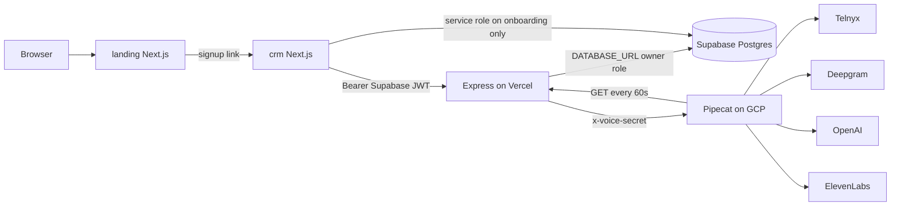

# Current architecture

**Verified:** 10 November 2026, read-only.  
**Sources:** this workspace, the connected Supabase project, and the connected Vercel team.  
**Not verified:** whether the GCP voice process is running at this moment, DNS records beyond Vercel domain objects, backups, and provider account health.

This workspace is one folder with four applications. It is not an npm workspace. There is no root `package.json`, no root README, and no `.github` workflow.

| Directory | Role | Runtime | Deploy target (verified) |
|---|---|---|---|
| `landing/` | Marketing site | Next.js 15, React 19, Tailwind 4 | Vercel project `landing`. Production domains `www.cortexflow.in` and `cortexflow.in` (apex redirects to www). Also `landing-mu-wine.vercel.app`. No environment variables on the project. |
| `crm/` | Product UI | Next.js 15, React 18, Tailwind 3, TypeScript 5 | Vercel project `crm`. Production domain `crm.cortexflow.in` (verified). Also `crm-sage-xi.vercel.app`. |
| `backend/` | API | Node, Express 4.18, `pg` 8.18 | Vercel project `cortex-backend-api`. Domain `cortex-backend-api.vercel.app`. `backend/vercel.json` builds `server.js` with `@vercel/node`. |
| `pipecat-server/` | Voice runtime | Python, FastAPI, Pipecat 0.0.108 | Not a Vercel project. Intended host is a GCP VM. Production `VOICE_SERVICE_URL` is set on the backend project. The VM process itself was not inspected over SSH. |
| `DOCS/` | Markdown | — | Not deployed |

Git deploys for CRM and API come from GitHub `nar0ttamm/cortex_full`, branch `main`. The newest READY production deployment of both, at audit time, is commit `cc15cd7b6d3b997380a4d7cb34b0979013ce47da`.

## How a request moves

`landing/app/lib/site.ts` points signup at `https://crm.cortexflow.in/signup`. The marketing app does not create users.

`crm/lib/supabase-client.ts` is a backend HTTP client. The name is historical. Lead reads and writes go to Express, not to PostgREST.

Express connects with `pg` in `backend/db.js`: `max: 1`, `ssl.rejectUnauthorized: false`. That connection uses `DATABASE_URL`. In Supabase this is the database owner, which bypasses row level security because `FORCE ROW LEVEL SECURITY` is off on every public table.

## Background work

| Job | Where it actually runs | Schedule in code | Schedule on Vercel |
|---|---|---|---|
| Queue worker `runQueueWorker` | Voice VM calls `GET /v1/internal/queue-worker` from `_queue_poller` in `pipecat-server/server.py` | every 60 seconds | `backend/vercel.json` cron is `0 0 * * *` (once a day) for `/v1/internal/queue-worker` |
| Same function again | `GET/POST /v1/internal/process-pending-calls` | same handler | not in `vercel.json` |
| Appointment reminders `runReminderJob` | Same poller also calls `/v1/internal/process-reminders` every 60 seconds | local `node-cron` in `backend/jobs/index.js` is hourly, and only when `node server.js` is the main module | Vercel cron is daily |
| `backend/jobs/callScheduler.js` | Not started by `jobs/index.js` | — | Dead relative to the current boot path |

`startJobs()` in `backend/jobs/index.js` runs only under `require.main === module`. Vercel imports `server.js` as a module, so the Node cron does not run in production. Production dialing depends on the Python poller.

## External services that the code calls

| Service | Called from | Purpose |
|---|---|---|
| Supabase Auth | `backend/middleware/auth.js`, CRM middleware | JWT validation, signup, login |
| Supabase Postgres | `backend/db.js` | All application data |
| Telnyx Call Control | `pipecat-server/server.py` | Outbound dial and media |
| Deepgram | `pipecat-server/bot.py` | STT |
| OpenAI | `bot.py` and `backend/config` fallback | Conversation LLM and post-call summary |
| ElevenLabs | `bot.py` | TTS |
| Resend | `backend/services/notificationService.js` | Email |
| AiSensy | same file | WhatsApp template campaigns |
| Google OAuth / Calendar | `backend/routes/googleCalendar.js` | Calendar tokens and events |
| Meta Graph | `backend/routes/metaIntegration.js` | Lead Ads OAuth and leadgen |

Not present in code: Stripe, Google Ads API, LiveKit, FreeSWITCH, n8n, Twilio, pgvector.

`livekit-server-sdk` is listed in `backend/package.json` and is not imported.
