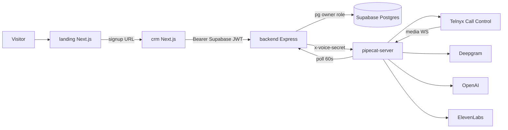
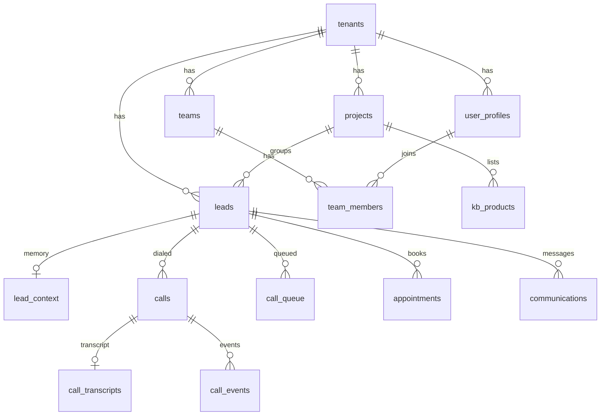
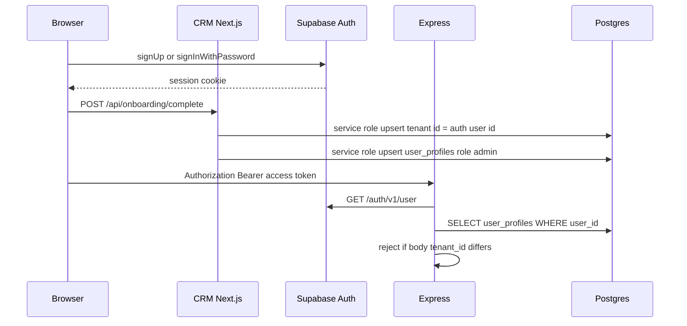
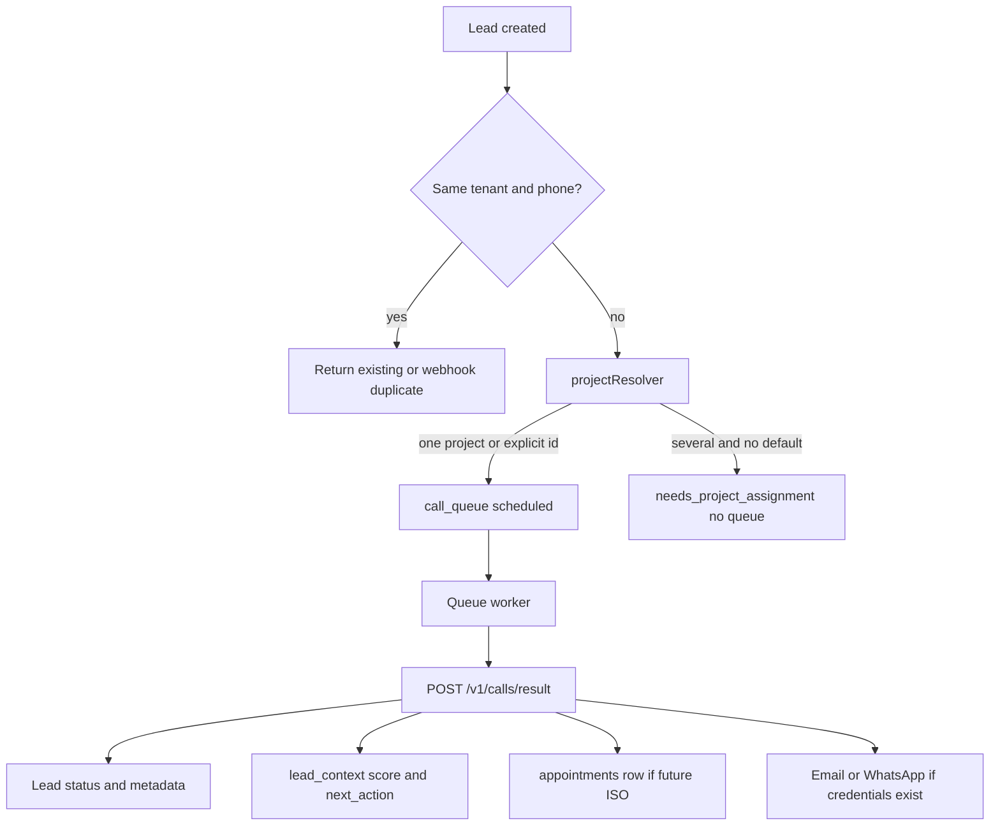
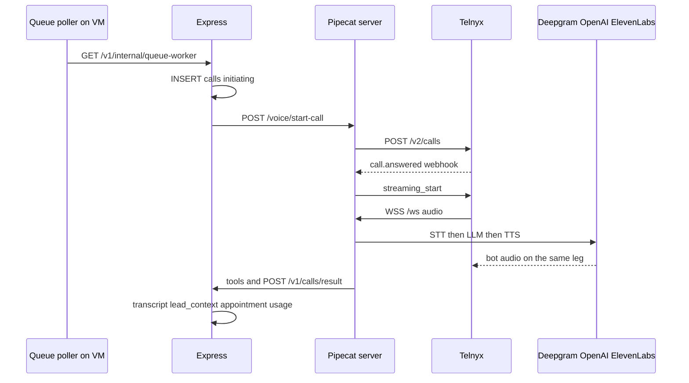
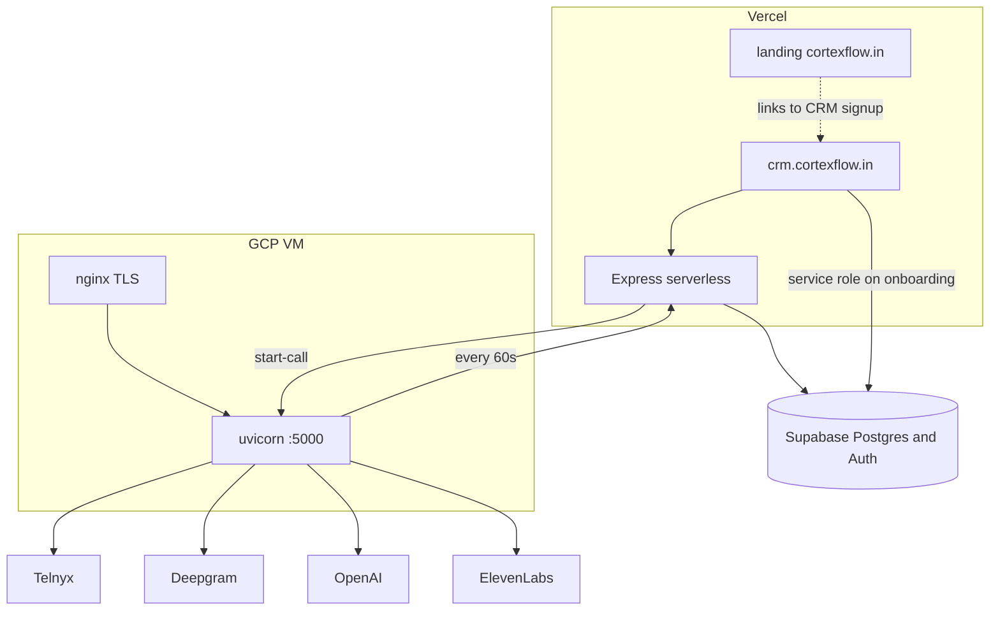

# CortexFlow — technical handover audit

**Date:** 10 November 2026  
**Scope:** repository as it exists, plus the live Supabase project this workspace is connected to.  
**Method:** read the code, configuration, and database catalog. No schema changes, no deploys, no outbound provider calls.  
**What this is not:** a claim that the product was exercised in a browser, and not a dependency-CVE scan. Backend unit tests were executed (18 passed). `npm audit` was not run.

Secrets, tokens, phone numbers, and tenant identifiers are omitted on purpose. Variable names are named. Values are not.

---

## 1. Executive technical summary

CortexFlow is a three-app product plus one voice process. It is not a formal monorepo (no workspace root, no shared packages, no CI).

| Piece | What it is | Where it runs |
|---|---|---|
| `landing/` | Marketing site | Intended: Vercel, `cortexflow.in` |
| `crm/` | Authenticated CRM | Intended: Vercel, `crm.cortexflow.in` |
| `backend/` | Express API on Postgres | Intended: Vercel, `cortex-backend-api.vercel.app` |
| `pipecat-server/` | FastAPI + Pipecat voice bot | Intended: one GCP VM, nginx TLS, port 5000 |
| Database | Supabase Postgres | Remote project used by the API |

The commercial loop the code actually implements:

1. A lead is created (CRM, CSV, public webhook, Meta leadgen, or demo form).
2. The backend inserts `leads` and, when a project can be resolved, a `call_queue` row.
3. The voice VM polls `GET /v1/internal/queue-worker` every 60 seconds.
4. The worker calls `startOutboundCall`, which inserts a `calls` row and `POST`s the VM `/voice/start-call`.
5. The VM dials Telnyx Call Control. On answer, Telnyx streams audio to `WSS /ws`. Pipecat runs Deepgram, OpenAI, and ElevenLabs.
6. The bot posts tools and a final result to the backend. The CRM reads that through JWT-authenticated `/v1` routes.

That loop has produced **11 completed call rows** in the database, the latest on **7 June 2026**. It has also produced **118,255 failed call rows**, almost all with `error_message = HTTP 502`, and **118,239 failed queue rows** with reason `Voice service error`. From 27 October through 8 November 2026 the table gained about **2,300–2,400 rows per day**. On 9 November that dropped to 340. On 10 November (the audit date) it was 2.

The cause is in the current code, not only in history. `migrateLegacyScheduledLeads()` in `backend/routes/internal.js` inserts a new queue row whenever a lead still has `metadata.scheduled_call_at` and `call_initiated` is not true, and it ignores rows already marked `failed`. A voice HTTP 502 does not set `call_initiated`. `canAttemptLead()` only counts rows whose `last_attempt_at` is set, and a failed attempt never sets that timestamp. The 60-second poller therefore re-dials the same leads. The backend records FastAPI's HTTP 502 as the generic string `HTTP 502` because it reads `error` while FastAPI returns `detail`. The database cannot tell a dead VM from a Telnyx rejection.

**Do not turn Telnyx origination on until that re-enqueue bug is fixed.** A working carrier would turn this loop into repeated live calls.

Other launch facts, all from code or the live catalog:

- Row Level Security is enabled on all 24 `public` tables and **there are zero policies**. `anon` and `authenticated` have `SELECT`, `INSERT`, `UPDATE`, `DELETE`, and `TRUNCATE` on every one of those tables. They are blocked only because RLS with no policy denies them. The backend connects as the database owner (`DATABASE_URL` via `pg`) and **bypasses RLS**. Tenant isolation is whatever each SQL string remembers to filter.
- `credentials` has **0 rows**. WhatsApp (AiSensy) and per-tenant Resend therefore have nothing to decrypt. Email can still send if the global `RESEND_API_KEY` env var is set. That was not verified live in this audit.
- `appointments` has **0 rows**. `knowledge_bases` has **0 rows**. `google_calendar_tokens` has **0 rows**. `kb_products` has **3 rows**. There is no vector store and no `pgvector` extension.
- Plans (`starter`, `growth`, `enterprise`) and a 3-day `trial_ends_at` are written at signup and never enforced. There is no Stripe.
- There is no root `README`, no `.github` workflow, and no Dockerfile. `livekit-server-sdk` is a dependency and is not imported. `DOCS/PRODUCT.md` and `DOCS/TECHNICAL_MANUAL.md` still describe a deleted LiveKit / FreeSWITCH stack.

The product to preserve is the CRM plus the Pipecat call path plus the Postgres model. The thing to stop before any customer pilot is the queue re-enqueue loop, and the thing to fix before more than one real company is on the system is database-level tenant isolation.

---

## 2. Technology stack

Versions below are the ranges declared in manifests, not a resolved lockfile audit.

### Frontend — CRM (`crm/package.json`)

| Concern | Actual choice |
|---|---|
| Framework | Next.js `^15.0.0`, App Router |
| React | `^18.2.0` |
| TypeScript | `^5` (`crm/tsconfig.json`) |
| Styling | Tailwind `^3.4.0`, CSS variables in `crm/app/globals.css` |
| Components | Hand-built. No MUI, shadcn, or Radix in dependencies |
| State | React local state, one `NotificationContext`. No Redux, Zustand, or React Query |
| Data | Server routes and `crm/lib/supabase-client.ts` call the Express API with the Supabase access token. The filename is historical. Leads are not read with the Supabase client |
| Auth | `@supabase/ssr` `^0.5.2`, `@supabase/supabase-js` `^2.45.0`. Middleware calls `getUser()` |
| Routing | Next file routes. `crm/middleware.ts` redirects anonymous users to `/login` |
| Forms | Uncontrolled inputs and manual checks. No Zod or React Hook Form |
| Charts | Custom SVG in `DashboardAnalyticsCharts.tsx`. `html-to-image` is a dependency |
| Email lib | `resend` is in the CRM package. Sending itself is implemented in the backend |

### Frontend — landing (`landing/package.json`)

Next.js `^15`, **React 19**, Tailwind **4** (`@tailwindcss/postcss`). This is a different major React and Tailwind than the CRM. They do not share a component library.

### Backend (`backend/package.json`, version 2.0.0)

| Concern | Actual choice |
|---|---|
| Runtime | Node, Express `^4.18.2` |
| API | One Express app, `backend/server.js`, exported for Vercel (`@vercel/node`) |
| DB | `pg` `^8.18.0`. Pool `max: 1` in `backend/db.js` because of serverless |
| Auth | Supabase Auth JWT checked by `GET {SUPABASE_URL}/auth/v1/user`, then `user_profiles` |
| Validation | Hand-written checks. No Joi, Zod, or express-validator |
| Logging | `console.log` / `console.error`. No structured logger, no request id |
| Rate limit | In-memory `Map` in `backend/middleware/rateLimit.js`, only on demo requests and `POST /v1/calls/start` |
| Jobs | `node-cron` locally. Production poller is inside the Python server. Vercel cron in `backend/vercel.json` is `0 0 * * *` (once a day) for both reminder and queue routes |
| Dead dependency | `livekit-server-sdk` `^2.15.1` is not required anywhere under `backend/` |

### Voice (`pipecat-server/requirements.txt`, `server.py`, `bot.py`)

| Concern | Actual choice |
|---|---|
| Server | FastAPI `>=0.115`, uvicorn `>=0.30` |
| Orchestrator | `pipecat-ai[deepgram,elevenlabs,openai,silero]==0.0.108` |
| Telephony | Telnyx Call Control v2. Answering-machine detection is disabled in code |
| Audio | Bidirectional RTP, PCMU, `stream_bidirectional_target_legs = self` |
| STT | Default `STT_MODE` is not flux: Deepgram `nova-3-general`, `language=multi`, 8 kHz, endpointing 100 ms. Optional Flux mode exists |
| VAD | Silero, confidence 0.7, start/stop 0.2 s. Used for barge-in and idle, not as the only turn detector |
| Turn taking | `SpeechTimeoutUserTurnStopStrategy(user_speech_timeout=0.6)` in nova mode |
| LLM | `OpenAILLMService`, model env `OPENAI_MODEL`, default `gpt-4o-mini` |
| TTS | ElevenLabs, model default `eleven_turbo_v2_5`, voice id from env |
| Concurrency | `MAX_CONCURRENT_CALLS`, default **4** on the VM, default **3** in the Node queue worker. They are separate knobs |

### Database

Postgres on Supabase. Extensions present: `plpgsql`, `pgcrypto`, `uuid-ossp`, `pg_stat_statements`, `supabase_vault`. **No `vector` / `pgvector`.** No `public` functions. No triggers. No storage buckets.

### Infrastructure as declared in repo and env templates

| Piece | Evidence |
|---|---|
| CRM and landing | `landing/app/lib/site.ts` points signup at `https://crm.cortexflow.in`. No `vercel.json` in `crm/` or `landing/` |
| API | `backend/vercel.json` builds `server.js` |
| Voice VM | `pipecat-server/.env.example` and `nginx-cortex-pipecat.conf`. nginx terminates TLS and proxies to port 5000. Domain in the example is a nip.io host for a GCP address. Region is documented as `asia-south1` in `DOCS/COST_FORECAST.md`; that file was not re-verified against GCP in this audit |
| Cron | VM poller every 60 s (`_queue_poller` in `server.py`). Vercel cron schedule does not match the comments in `internal.js` |
| Monitoring | `/health` on API (runs `SELECT 1`) and `/health` on the voice server (reports which provider env vars are non-empty, and returns the configured caller ID and domain) |
| Backups | Not defined in the repo. Whatever Supabase project backups exist was not inspected |
| CI | None in the repo |

`backend/env.template` still describes Exotel and `CALLING_MODE=simulated`. The live dial path does not read `CALLING_MODE`. It dials whenever `VOICE_SERVICE_URL` is set. That comment is stale and dangerous if someone treats the template as the runbook.

---

## 3. Repository structure

Multi-service folder, not an npm/pnpm workspace. About 150 source files excluding lockfiles, docs, and assets. No generated `node_modules` were treated as source.

```
/
├── landing/                 Marketing site (Next.js 15, React 19, Tailwind 4)
│   ├── app/page.tsx         Single homepage (product, pricing, FAQ are anchors)
│   ├── app/get-started/     Demo / get-started flow
│   ├── app/signin/          Sign-in shell that sends people to the CRM
│   └── app/lib/site.ts      CRM URL and contact email
├── crm/                     Product UI (Next.js 15, React 18, Tailwind 3)
│   ├── app/                 Pages and a few Route Handlers
│   ├── app/api/             CSV import, lead notes proxy, onboarding, stats
│   ├── lib/                 Auth, backend fetch, analytics helpers
│   └── middleware.ts        Session gate
├── backend/                 Express API
│   ├── server.js            Mounts every router
│   ├── routes/              HTTP surface
│   ├── services/            Call, score, notify, queue, KB selection
│   ├── integrations/        Webhook normalize + HMAC helper
│   ├── jobs/                Local cron + reminder query
│   ├── middleware/          JWT, voice secret, cron secret, rate limit
│   ├── migrations/          One SQL file only
│   └── tests/               conversion.test.js (18 tests, all passing)
├── pipecat-server/          FastAPI + Pipecat + Telnyx
│   ├── server.py            Dial, webhook, websocket, queue poller
│   ├── bot.py               Prompt, tools, STT/LLM/TTS pipeline
│   └── *.sh, nginx conf     VM install and TLS proxy
├── DOCS/                    Mixed-age markdown. See section 17
├── cortexflow-status.sh
└── _provision.sh
```

There is no root README, no test for the CRM or the voice server, and no `supabase/migrations` history that can rebuild the database.

### How the modules connect



### Duplication and dead weight

| Item | Evidence | Status |
|---|---|---|
| `backend/routes/calls.js` | `POST /call/event`, `POST /call/simulate` | Older call-event path still mounted beside `newCalls.js` |
| `crm/lib/supabase-client.ts` | Comment says it talks to the backend, not Supabase | Name is misleading; behavior is the API client |
| `livekit-server-sdk` | In `backend/package.json`, zero imports | Dead dependency |
| `DOCS/PRODUCT.md`, `DOCS/TECHNICAL_MANUAL.md`, `DOCS/AI_CONTEXT.md` | LiveKit room, FreeSWITCH, Twilio, OpenAI Realtime | Describe a stack the Python file header says it replaced |
| `CALLING_MODE` / Exotel | `env.template`, lead metadata still stores `calling_mode` | Not the dial switch |
| Reminder flags | `appointments.reminder_1day_sent` columns exist; `reminderJob.js` reads `leads.metadata` | Two models, one is unused |
| `knowledge_bases` vs `kb_products` | Both exist. Table `knowledge_bases` has 0 rows. Prompt uses product rows | The prose KB is unused in production data |

`crm/app/pipeline/page.tsx` and `crm/app/analytics/page.tsx` exist and are auth-gated. The sidebar `NAV` array does not link to them. Dashboard charts live on `/` via `DashboardAnalyticsCharts.tsx`. Treat those two routes as present and unlinked until someone clicks them.

---

## 4. Frontend architecture

### Landing

`landing/app/page.tsx` is one long page: header, hero, feature bento, how-it-works, industries, pricing carousel, FAQ, footer. There are no separate `/pricing` or `/product` routes. Navigation in `site.ts` is in-page anchors.

Signup is not performed on the landing app. `CRM_SIGNUP` is `https://crm.cortexflow.in/signup`. `/get-started` is a local flow (`GetStartedFlow.tsx`). `/signin` is a shell. Demo booking copy exists (`BookDemoButton.tsx`). The backend demo endpoint is `POST /v1/demo/request`, which is a different path from the marketing page; this audit did not trace the button's fetch target in the browser.

Metadata is set in `landing/app/layout.tsx` (`title: CortexFlow AI — calling CRM that never clocks out`). Claims on the page include AI calling every lead in under two minutes, WhatsApp + email + voice in one thread, and appointments landing on a calendar. Those claims are ahead of the production data in section 1.

### CRM

Auth wall: `crm/middleware.ts`. If Supabase env is missing, middleware **allows the request through**. Protected prefixes include `/`, `/leads`, `/calls`, `/pipeline`, `/analytics`, `/appointments`, `/tenant`, `/integrations`, `/team`, `/projects`. `/api` and `/auth` are not gated by this middleware; each route checks auth itself, or does not.

Sidebar destinations (`crm/app/components/Sidebar.tsx`): Dashboard, Leads, Communications, Calls, Appointments, Data, Integrations, Projects, Team, Usage, plus a settings link to `/tenant`.

| Route | Role in the product | Data source |
|---|---|---|
| `/` | Dashboard and charts | Backend via CRM helpers |
| `/leads`, `/leads/[id]` | List and detail, notes, conversion panel | `GET/PATCH /v1/leads...`, notes API routes |
| `/communications` | WhatsApp / email thread UI | Backend notifications and `communications` |
| `/calls` | Call history | `GET /v1/calls/:tenantId` |
| `/appointments` | Calendar | Lead metadata and `/v1/appointments` |
| `/data` | CSV import / export | `crm/app/api/import/route.ts` → `POST /v1/lead/ingest` |
| `/integrations` | Webhook setup | `/v1/integrations/...` |
| `/projects` | Project wizard | `/v1/projects` |
| `/team` | Users and teams | `/v1/users`, `/v1/teams` |
| `/usage` | Counters, explicitly "not a plan limit" | `usage/page.tsx` |
| `/tenant` | Company settings | `GET/PATCH /v1/tenant/:id` |
| `/signup` | 3-step account creation | Supabase `signUp` then `POST /api/onboarding/complete` |
| `/login` | Password sign-in | `signInWithPassword` |
| `/pipeline`, `/analytics` | Pages exist | Not in the sidebar |

There is no tasks module, no separate follow-up object, and no calendar sync UI with data behind it (`google_calendar_tokens` is empty). Follow-up is `lead_context.next_action` plus queue rows plus lead metadata.

Signup (`crm/app/signup/page.tsx`) collects name, company, phone, industry, GSTIN, address, and a plan card. Plan cards advertise 100 / 1,000 / unlimited AI calls. Nothing in the backend reads those numbers.

---

## 5. Backend architecture

`backend/server.js` is the whole API.

Middleware order:

1. CORS. Allowed origins: `CRM_URL` (default `https://crm.cortexflow.in`), `https://cortexflow.in`, `https://www.cortexflow.in`, and **any** `*.vercel.app`. Missing `Origin` is allowed (server-to-server and curl). Non-production allows every origin.
2. JSON body limit 1 MB. URL-encoded bodies are enabled (comment still says Exotel).
3. For paths other than `/health` and `isPublicPath`, anything under `/v1` requires a Supabase user JWT.

Public prefixes (`backend/middleware/auth.js`): `/health`, `/v1/webhook/`, `/v1/demo/`, `/v1/calls/result`, `/v1/calls/tools`, `/v1/internal/`, `/v1/email/inbound`, `/v1/meta/webhook`, `/v1/meta/callback`, `/v1/google-calendar/callback`. Several of those then check a shared secret inside the handler. Some do not. See section 15.

JWT check: `requireUser` calls Supabase `/auth/v1/user`. It can send the service-role key as `apikey` if the anon key is unset (`auth.js` lines 52–55). Membership comes from `user_profiles`. If no profile row exists, the user is treated as **admin of a tenant whose id is their own auth user id**. A claimed `tenant_id` in body, query, or `params.tenantId` must match. That check is real and is an improvement over older docs that said `/v1` was open.

Authorization beyond the tenant check is thin. `req.role` is loaded. It is enforced on user create and some team mutations (`admin` or `manager`). It is **not** enforced on tenant settings, credential **read**, lead lists, or call start. Any member of the tenant can read decrypted credentials.

Errors: one handler returns `err.message` to the client. That leaks internal exception text.

Business logic worth knowing:

- `services/startOutboundCall.js` is the only dial entry used by the CRM, the queue, and (via demo) the public form.
- `services/callContextBuilder.js` builds the brief. It does not dump a document corpus.
- `services/productSelector.js` picks `kb_products` rows with SQL filters, not embeddings.
- `services/leadScore.js` is a deterministic scorer. The tests cover it. It is not a model.
- `services/usageTracker.js` increments counters and never refuses a call.
- `services/notificationService.js` sends Resend email and AiSensy template campaigns. Failures are swallowed so lead insert still succeeds.

`db.js` sets `ssl.rejectUnauthorized: false` and `max: 1`. One slow query blocks that isolate's pool.

---

## 6. Database architecture

24 application tables, all `tenant_id`-scoped except `call_events`, `call_transcripts`, `integration_sources`, and `demo_requests`. Transcripts and events hang off `call_id` only. A query that fetches a transcript by call id without joining `calls.tenant_id` is a cross-tenant read. The calls list does join from a tenant-filtered `calls` row, which is the safe pattern. Not every route was proven to do that.

Row counts are `pg_stat_user_tables.n_live_tup` estimates at audit time, plus exact `count(*)` on `calls` and `call_queue` statuses.

| Table | Purpose | Tenant | Rows (approx.) | RLS |
|---|---|---|---|---|
| `tenants` | Company. `plan`, `trial_ends_at`, `settings`, `onboarding_completed` | self | 6 | on, no policy |
| `user_profiles` | Auth user → tenant, `role`, `is_active` | `tenant_id` | 6 | on, no policy |
| `teams`, `team_members` | Team and membership | team via `teams.tenant_id` | 3 / 1 | on, no policy |
| `projects` | What the AI is allowed to sell | `tenant_id` | 3 | on, no policy |
| `leads` | Person. Unique `(tenant_id, phone)` | `tenant_id` | 18 | on, no policy |
| `lead_context` | Score, objections, next action, memory. One row per lead | `tenant_id` | 7 | on, no policy |
| `call_queue` | Dial jobs | `tenant_id` | 118,241 (118,239 failed, 2 retry) | on, no policy |
| `calls` | One row per dial attempt | `tenant_id` | 118,267 (118,255 failed, 11 completed, 1 initiating) | on, no policy |
| `call_transcripts` | `full_transcript`, `summary`. Unique `call_id` | **none** | 11 | on, no policy |
| `call_events` | Event log | **none** | 11 | on, no policy |
| `call_analytics` | Barge-in, silence, tool counts | `tenant_id` | 4 | on, no policy |
| `appointments` | Calendar rows, Google event id, reminder flags | `tenant_id` | **0** | on, no policy |
| `communications` | WhatsApp / email log | `tenant_id` | 120 | on, no policy |
| `credentials` | AES blob per `(tenant_id, service)` | `tenant_id` | **0** | on, no policy |
| `knowledge_bases` | Brand voice, calling rules, prose | `tenant_id` | **0** | on, no policy |
| `kb_products` | Structured property rows | `tenant_id` + `project_id` | 3 | on, no policy |
| `integrations` | Per-tenant webhook secret and encrypted creds | `tenant_id` | 1 | on, no policy |
| `integration_sources` | Catalog of source types | global | 8 | on, no policy |
| `integration_logs` | Inbound payloads | `tenant_id` | 3 | on, no policy |
| `google_calendar_tokens` | Access and refresh tokens **in plaintext columns** | `tenant_id` | **0** | on, no policy |
| `tenant_usage` | Monthly counters. Unique `(tenant_id, month)` | `tenant_id` | 9 | on, no policy |
| `activity_logs` | Audit-ish events | `tenant_id` | 8 | on, no policy |
| `demo_requests` | Public demo form | **none** | 3 | on, no policy |

Tenants in the database: 6, all `status = active`. Plans: starter 4 (one with `onboarding_completed = false`), growth 2, enterprise 1. These are labels.

Indexes that matter: unique `(tenant_id, phone)` on leads; queue index on `(tenant_id, status, scheduled_at)` and a partial index for queued/retry; calls by tenant, lead, status, `created_at`. No index on `call_transcripts` by tenant because that column does not exist.

Foreign keys are present for the relationships above (queried from `information_schema`). `call_transcripts.call_id` → `calls.id`. `call_events.call_id` → `calls.id`. `team_members` has no `tenant_id`; isolation depends on joining `teams`.



Storage: no buckets. Recordings are not stored as files in this database. Transcript text is.

Migrations: the repo contains a single file, `backend/migrations/20260920_lead_context_conversion.sql`. The live schema is much larger and is not reproducible from git. That is an operational risk, not a reason to rewrite the schema.

---

## 7. Authentication and tenant architecture



What is automated: Supabase creates the auth user. `crm/app/api/onboarding/complete/route.ts` then, with the **service role**, upserts a tenant whose id is the auth user id, a profile with `role = admin`, a default team, and `onboarding_completed = true` immediately. Trial end is now + 3 days. No project, no product, no phone number, no WhatsApp sender, and no calling hours are created.

What is manual after that: a project (`ProjectWizard`), products, credentials (admin token route), Meta OAuth, Google OAuth.

`crm/lib/auth.ts` resolves the tenant from `user_profiles` using the service role. It does **not** trust `user_metadata.tenant_id`. That matches the backend. Older audits that called metadata a tenant-hop bug are stale.

Invited users: `POST /v1/users/create` (admin or manager) uses the Supabase admin API. This audit did not execute it.

Password recovery and email verification are whatever the Supabase project has turned on. The CRM has `/auth/callback` for the code exchange. There is no custom recovery UI in the file list beyond login and signup. Leaked-password protection is **disabled** (Supabase security advisor).

Roles that exist as strings: `admin`, `manager`, and the default `executive` when a profile has no role. Team membership does not filter the lead list. An executive sees the tenant's leads.

---

## 8. CRM workflow



| Module | Implementation | Evidence |
|---|---|---|
| Dashboard | Real aggregates from leads the API returns, plus charts | `crm/app/page.tsx`, `analyticsFromLeads.ts` |
| Leads | CRUD through the API. Status is a varchar, not a state machine table | `backend/routes/leads.js` |
| Lead detail | Notes routes under `crm/app/api/leads/...` | Present |
| Sources | Free-text `leads.source` plus integration catalog | `integration_sources` has 8 keys |
| Pipeline | Page file exists. Status updates are `PATCH /v1/leads/:id` | Not linked in the sidebar |
| Assignment | `leads.assigned_to` → `user_profiles.id`. PATCH accepts it | No round-robin in the worker |
| Scoring | Rule function `scoreLead` after a call, stored on `lead_context` | Tested. Not ML |
| Call history | `calls` joined to transcripts, default limit 50, **limit is not capped** | `newCalls.js` |
| Tasks | No table | Missing |
| Follow-ups | `next_action` / `next_action_at` and callback queue | `nextAction.js`, `callbackSchedule.js` |
| Appointments | UI plus `appointments` table. Table is empty | Code path exists, production rows do not |
| Calendar sync | Google OAuth routes | 0 token rows |
| Team | Teams, members, invite route | Role checks on some mutations only |
| Settings | Tenant name and `settings` JSON. Any member can PATCH | `admin.js` |

Lead statuses used in queries include `new`, `contacted`, `interested`, `qualified`, `not_interested`, `closed`. There is no database enum.

---

## 9. Calling architecture

### Where each piece runs

| Step | Process | File |
|---|---|---|
| Choose the lead | CRM button or queue worker | `startOutboundCall.js` |
| Refuse if a call is already `In Progress` | Backend | same, conditional UPDATE |
| Require a project | Backend | `projectResolver.js` |
| Insert `calls` status `initiating` | Backend, before the dial | `startOutboundCall.js` |
| Build brief and up to a few products | Backend | `callContextBuilder.js`, `productSelector.js` |
| POST `/voice/start-call` with `x-voice-secret` | Backend → VM, 25 s abort | `startOutboundCall.js` |
| Capacity check, default 4 | VM memory | `server.py` |
| Telnyx `POST /v2/calls` | VM → Telnyx | `_make_telnyx_call` |
| `call.answered` webhook | Telnyx → VM | Ed25519 verify, then `streaming_start` |
| Audio | Telnyx → `WSS /ws` | PCMU, bidirectional, target leg `self` |
| STT, LLM, TTS | VM process | `bot.py` |
| Tools | VM → backend `/v1/calls/tools/*` with voice secret | `bot.py` handlers |
| Hangup and summary | VM → `POST /v1/calls/result` | `notify_backend` |
| CRM update | Backend transaction | `newCalls.js` |

State that dies with the process: `_pending_calls`, `_streaming_started`, `_active_calls`. A VM restart drops dials that have not reached the websocket. The `calls` row remains.

### One outbound call



### Providers and behavior that are actually coded

| Capability | In code? | Proven by a test or by production rows? |
|---|---|---|
| Telnyx outbound Call Control | Yes | 11 completed calls exist, last 7 June 2026. Current failures are HTTP 502 from the voice HTTP call. Whether those 502s are Telnyx errors wrapped by FastAPI is **not distinguishable** in the DB |
| Deepgram nova-3, language `multi` | Yes, default path | Not covered by tests |
| Hindi / Hinglish / English | Prompt says default Hindi/Hinglish and switch to English if the caller speaks English. STT `language=multi` can feed that. No language detector, no second voice | Prompt only, plus 11 historical transcripts this audit did not read |
| Silero barge-in | Yes, VAD params in `bot.py` | `call_analytics` has 4 rows. Not a test suite |
| Endpointing | Deepgram 100 ms plus 0.6 s speech timeout | Code only |
| Interruptions | Pipecat VAD on the user aggregator | Code only |
| Silence | `SILENCE_HANGUP_S` default 20 in `.env.example`; idle strategy uses `IDLE_TIMEOUT_S` | Confirm the constant in `bot.py` before treating 20 s as live |
| Max duration | `MAX_CALL_DURATION_S` default 300 in the example env | VM env, not verified live |
| Retry | Intended max 2/day in `callQueueService.js` | **Broken** for 502s. See section 1 |
| AMD / voicemail | Explicitly disabled | Will talk to voicemail |
| Inbound PSTN | No product path | Outbound only |
| Per-tenant caller ID | No | One `TELNYX_PHONE_NUMBER` |
| Recording files | No bucket | Transcript text only |
| Human escalation mid-call | Prompt does not transfer the call. `human_handoff` is a score flag | No telephony transfer |

Tools the model can call: `search_project_products`, `update_lead_memory`, `book_appointment`, `end_call`. Search hits the backend and `kb_products`. Booking stores an ISO the model invented; the backend rejects past times and times more than 366 days out, then writes lead metadata and an `appointments` row. The appointments table being empty means either no call has passed that validator since the insert was added, or rows were removed. Three historical `calls.outcome = appointment_booked` rows exist (21 Apr, 27 Apr, 5 May 2026). They did not leave rows in `appointments` now.

The system prompt tells the model not to say it is an AI or that it is CortexFlow, and to claim it is a female representative of the tenant. That is a product and compliance decision, not a technical capability. There is no consent field on `leads`.

`/health` on the voice server returns whether keys are non-empty and returns the caller ID and domain. It does not place a call. This audit did not request it.

---

## 10. AI prompt and knowledge base

There is no ingestion pipeline for PDFs, no chunking, no embeddings, and no retrieval index. `pgvector` is not installed. `knowledge_bases` is empty.

What the model sees on a call is the string from `build_system_prompt()`:

- Tenant name, a short brand voice and calling rules if a `knowledge_bases` row exists (none do).
- Previous `lead_context` (budget, location, objections, last summary).
- A short list of `kb_products` chosen by `productSelector.js`.
- Hard-coded sales steps and objection lines aimed at Indian real-estate site visits.

`search_project_products` can query further products in the same project during the call. If the catalog does not contain the fact, the model has no grounded fallback other than the instruction not to guess when it did not hear the caller. It is not told to refuse unknown property facts. Hallucinated prices and possession dates are an expected failure mode of this design.

Isolation of products is `tenant_id` and `project_id` in the SQL. That is application-level, and the voice tool routes are protected by `x-voice-secret`, not by a user JWT. Anyone who has the voice secret can query any tenant's products by passing ids. The secret is a server credential, which is the right place for it, as long as it stays off the client.

---

## 11. WhatsApp and email

| Channel | Code | Production data |
|---|---|---|
| Email outbound | Resend HTTPS API in `notificationService.js`. Per-tenant decrypted `credentials` service `resend`, else env `RESEND_API_KEY` | `credentials` is empty. Whether the global key is set on Vercel was not read. `communications` has about 120 rows, so some messages have been logged historically |
| Email inbound | `POST /v1/email/inbound` | **No signature check.** Looks up `leads.email` with no tenant filter, latest row wins. Response body includes lead id and name. Public path |
| WhatsApp | AiSensy campaign API, template params, not free-form session text | Needs `credentials` service `aisensy` or env `AISENSY_API_KEY`. Zero credential rows. `DOCS/CORTEXFLOW_SYSTEM.md` still says Twilio. The code does not call Twilio |
| Opt-out | Not implemented | No suppression list |
| Delivery webhooks | Not implemented for AiSensy | Status in `communications` is whatever the send function wrote at request time |
| Scheduling | Lead-entry, appointment, callback, and the hourly reminder job | Reminder job reads lead metadata, and there are 0 appointment rows. WhatsApp send no-ops without credentials |

`sendLeadEntryNotifications` addresses the admin using `config.adminEmail` and `config.adminPhone`, which fall back to constants in `backend/config/index.js`, not to the tenant's settings. A new tenant's leads can notify the platform owner.

---

## 12. Appointments and automations

| Behavior | Real? |
|---|---|
| Create from the CRM | `POST /v1/appointment/schedule` writes the API. UI page exists. 0 rows, so this has not survived in the current database |
| Create from a call | `appointmentFromCall.js` writes metadata and `appointments` if the ISO is in the future | Code is real. Table is empty |
| Conflict check | Not found. Two bookings at the same time are allowed |
| Timezone | Naive ISO is treated as IST (`+05:30`) | Explicit in `appointmentFromCall.js` |
| Google Calendar | OAuth routes and plaintext token table | 0 tokens. Not a live sync |
| Reminders | Hourly job, 23–25 h and a 3 h window, via WhatsApp helper | Depends on metadata and on AiSensy |
| Callback | `callbackSchedule.js` parses phrases to an ISO and enqueues | Unit-tested for a few phrases |
| Cancellation / reschedule | `POST /v1/appointment/update` | No production rows to confirm |
| Team notification | Same notification service | Skips without credentials |
| n8n | Not in the repo. Package description says "n8n-free" | There is no workflow engine |
| Automations the user can edit | None | Fixed code paths only |

`backend/vercel.json` schedules reminders and the queue worker at `0 0 * * *`. The comments in `internal.js` say every minute and every hour. The process that actually polls every minute is the VM. If the VM is down, those jobs wait until the next Vercel midnight tick, and only if `CRON_SECRET` is accepted.

---

## 13. API inventory

Auth abbreviations: **JWT** = Supabase user and tenant match. **Voice** = `x-voice-secret`. **Cron** = bearer cron secret or voice secret. **Admin** = `x-admin-token`. **Public** = no check. Unless noted, JWT routes are mounted under `/v1` and pass through `requireUser`.

### Leads — `backend/routes/leads.js`

| Method | Route | Auth | Purpose |
|---|---|---|---|
| POST | `/v1/lead/ingest` | JWT | Create lead, dedupe on phone, enqueue |
| GET | `/v1/leads/:tenantId` | JWT | List |
| GET | `/v1/leads/:tenantId/:leadId` | JWT | Detail |
| GET | `/v1/leads/by-phone/:tenantId/:phone` | JWT | Lookup. Registered after `/:leadId`, so the literal path can be captured as an id. Confirm before relying on it |
| PATCH | `/v1/leads/:leadId` | JWT | Status, metadata, project, assignee |
| POST | `/v1/lead/status` | JWT | Status helper |
| POST | `/v1/leads/:leadId/notes` | JWT | Add note |
| DELETE | `/v1/leads/:leadId/notes/:noteId` | JWT | Delete note |
| POST | `/v1/lead/metadata` | JWT | Metadata merge |
| GET | `/v1/analytics/conversion` | JWT | Conversion aggregates |

### Calls

| Method | Route | Auth | Purpose |
|---|---|---|---|
| POST | `/v1/calls/start` | JWT, in-memory rate limit 20/min | Manual dial |
| POST | `/v1/calls/result` | Public prefix + voice secret | Pipecat final result |
| GET | `/v1/calls/:tenantId/summary` | JWT | Active and total counts. Total scans the tenant's call rows |
| GET | `/v1/calls/:tenantId` | JWT | List. `limit` query is unbounded |
| POST | `/v1/call/event` | JWT | Legacy event writer |
| POST | `/v1/call/simulate` | JWT | Legacy simulator |
| POST | `/v1/calls/tools/search-products` | Voice | Catalog search |
| GET | `/v1/calls/tools/product/:productId` | Voice | One product |
| POST | `/v1/calls/tools/update-lead-memory` | Voice | `lead_context` |
| POST | `/v1/calls/tools/log-analytics` | Voice | `call_analytics` |
| GET | `/v1/calls/analytics` | JWT | Analytics read |
| GET | `/v1/calls/usage/:tenantId` | JWT | Usage counters |

### Voice process (not Express)

| Method | Route | Auth | Purpose |
|---|---|---|---|
| POST | `/voice/start-call` | `x-voice-secret`, else 503 | Dial |
| POST | `/telnyx-webhook` | Ed25519, unless public key missing (then verify returns true) or `TELNYX_WEBHOOK_ENFORCE=false` | Call events |
| WS | `/ws` | No shared secret. Depends on Telnyx handshake inside the bot | Media |
| GET | `/health` | Public | Config flags and caller ID |

### Integrations, Meta, Google, email, demo

| Method | Route | Auth | Purpose |
|---|---|---|---|
| POST | `/v1/webhook/:tenantId/:integrationKey` | Public. HMAC or bearer if a secret is stored. **If `webhook_secret` is null, accept** | Lead ingest |
| GET | `/v1/webhook/:tenantId/:integrationKey` | Public. Echoes `hub.challenge` **without a verify token** | Challenge |
| GET | `/v1/integrations/supported` | JWT | Catalog |
| GET/POST/DELETE | `/v1/integrations/:tenantId...` | JWT | CRUD, regenerate secret, logs, test |
| GET | `/v1/meta/auth` | JWT | OAuth start |
| GET | `/v1/meta/callback` | Public prefix | OAuth return |
| GET | `/v1/meta/webhook` | Public. Checks `META_WEBHOOK_VERIFY_TOKEN` | Meta verify |
| POST | `/v1/meta/webhook` | Public. **No `X-Hub-Signature` check.** Returns 200 immediately | Leadgen |
| GET/DELETE | `/v1/meta/status`, `/v1/meta/disconnect` | JWT | Status |
| GET | `/v1/google-calendar/auth` | JWT | OAuth start |
| GET | `/v1/google-calendar/callback` | Public prefix | OAuth return |
| GET/POST/DELETE | status, create-event, disconnect | JWT | Calendar |
| GET/POST | `/v1/email/inbound` | Public. No Resend signature | Inbound mail |
| POST | `/v1/demo/request` | Public. 5/hour/IP in one process | Creates a lead and dials |
| POST | `/v1/demo/whatsapp-interaction` | Public | Demo tracking |

### Everything else

| Method | Route | Auth | Purpose |
|---|---|---|---|
| GET | `/health` | Public | DB ping. Error message included on failure |
| GET | `/v1/me` | JWT | User, tenant, role |
| GET/POST | `/v1/internal/queue-worker`, `process-pending-calls`, `process-reminders` | Cron | Jobs. Both pending-calls and queue-worker run the same function |
| POST | `/v1/appointment/schedule`, `/appointment/update` | JWT | Appointments |
| GET | `/v1/appointments/:tenantId` | JWT | List |
| GET | `/v1/credentials/:tenantId/:service` | JWT, **any role, returns decrypted JSON** | Secret read |
| POST/DELETE | `/v1/admin/credentials...` | Admin token | Secret write |
| POST | `/v1/admin/tenant` | Admin token | Create tenant |
| GET/PATCH | `/v1/tenant/:tenantId` | JWT, any role | Read and update settings |
| GET/POST/PATCH/DELETE | `/v1/projects`, `/v1/teams`, members | JWT. Some writes require admin or manager | Org structure |
| GET/POST/PATCH | `/v1/users` | JWT. Create and some updates check role | Users |
| GET/POST/PATCH/DELETE | `/v1/kb`, `/v1/kb/products` | JWT | Knowledge |
| GET/POST | `/v1/activity` | JWT | Activity log |
| POST | `/v1/notifications/send` | JWT | Manual send |

CRM Route Handlers, all under `crm/app/api/`, are a second surface: `import`, `stats`, `me`, `activity`, `crm-data`, lead notes, `leads/[leadId]/notify`, `onboarding/complete`, `auth/logout`, `auth/callback`. Onboarding uses the service role. The others should be checked per file before exposing them; notes and import call `requireAuth` or the backend with the user token.

No Google Ads OAuth implementation was found. Google Lead Forms is a webhook catalog entry, not an Ads API client.

---

## 14. Infrastructure and deployment



Confirmed in the repo: three Node deployables and one Python process; Supabase as the only database; Telnyx as the only carrier in code; nginx config for the VM.

Not confirmed by this audit, because no cloud APIs were called: that the VM is currently running, that DNS matches the nip.io example, that Vercel production env contains `VOICE_SECRET`, or that backups are enabled. `DOCS/CORTEXFLOW_SYSTEM.md` (20 September 2026) says the VM and Vercel projects existed then. The call-row time series through 10 November 2026 shows something was still inserting failed dials as recently as this morning, which means the poller and the API were both reachable recently. That does not mean a live phone call completed.

Deploy process in the repo: shell scripts under `pipecat-server/` (`deploy.sh`, `provision_remote.sh`, `setup_server.sh`). No GitHub Actions. Frontend and API deploys are manual Vercel CLI or dashboard, according to older docs, not according to a pipeline file.

Recovery: not documented in a way that matches the current process. Restoring service is "boot the VM, set env, start uvicorn, hope Vercel env matches." The 118k failed rows will still be there.

---

## 15. Security assessment

Release-blocking items are marked **P0**. The rest are real and should not wait for a redesign, but they are not the first fire.

### P0 — release blocking

1. **Queue re-enqueue on voice failure.** `migrateLegacyScheduledLeads` plus `canAttemptLead` ignoring attempts that never set `last_attempt_at`. Evidence: 118,255 failed `calls`, ~2,400/day for two weeks, code path still present. If Telnyx starts succeeding, those leads are called every minute.
2. **Tenant isolation is not enforced by the database.** RLS on, zero policies, owner connection bypasses RLS, service role bypasses RLS. `anon` has `TRUNCATE` on every public table, including `credentials` and `google_calendar_tokens`. The anon key is a public browser key. The only thing stopping a wipe is "RLS stays enabled." Supabase advisor `rls_enabled_no_policy` lists all 24 tables: https://supabase.com/docs/guides/database/database-linter?lint=0008_rls_enabled_no_policy
3. **`GET /v1/credentials/:tenantId/:service` returns decrypted provider secrets to any logged-in member of that tenant.**
4. **Inbound email webhook is unauthenticated and cross-tenant.** First matching email wins. Response includes the lead's name.
5. **Meta leadgen POST does not verify `X-Hub-Signature-256`.** It acknowledges before processing.
6. **Webhooks with a null secret are open**, and the GET challenge endpoint echoes `hub.challenge` with no token.
7. **Public demo dial.** `POST /v1/demo/request` creates a lead on the default tenant and starts a call. The rate limit is an in-memory map keyed by the first `X-Forwarded-For` value. On Vercel that map does not survive the next isolate, and the header is client-influenced. This is a toll-fraud and harassment path the moment dialing works.

### P1 — fix before more than a design partner

- Google OAuth tokens are plaintext columns. Integration webhook secrets are plaintext. Credential encryption is AES-256-CBC with no authentication tag and no rotation (`encryption.js`).
- `call_transcripts` and `call_events` have no `tenant_id`.
- Any tenant member can `PATCH /v1/tenant/:id` (name and settings).
- CORS allows every `*.vercel.app` origin.
- `GET /v1/calls/:tenantId` accepts an uncapped `limit` and joins full transcripts.
- `/health` on the API returns exception text. Voice `/health` returns the caller ID.
- Voice `/ws` has no shared secret of its own.
- Users with no `user_profiles` row are treated as admin of `tenant_id = auth.uid`.
- Leaked-password protection is off: https://supabase.com/docs/guides/auth/password-security#password-strength-and-leaked-password-protection
- No consent capture, no opt-out, no retention job, no delete-my-data path. The prompt hides that the caller is talking to a model.
- Admin notification constants in `config/index.js` are a platform inbox, not the tenant's.
- `ssl.rejectUnauthorized: false` on the Postgres connection.
- Service-role key is used from Next server routes. It is not prefixed `NEXT_PUBLIC_` in the code that was read. Keep it that way.

### Not found, so not claimed

No dynamic SQL built from string concatenation of user input was sampled as an obvious injection sink; queries use `$1` placeholders. That is not a full injection audit. XSS: React text nodes are the default; email HTML is escaped in the notification helper. A full XSS pass was not done. No penetration test was run.

---

## 16. Testing and code quality

Executed during this audit:

```
backend/tests/conversion.test.js
18 tests, 18 passed, 0 failed
```

They cover `leadScore`, `projectResolver.decideProjectAssignment`, `callbackSchedule.parseCallbackWhen`, `nextAction`, and `conversionAnalytics`. They do not boot Express, do not touch Postgres, and do not cover auth, webhooks, dialing, or the queue worker.

| Kind | Present? |
|---|---|
| Unit tests beyond conversion | No |
| API integration tests | No |
| CRM tests | No |
| Playwright / browser | No |
| Voice tests | `pipecat-server/testcall.sh` is a script, not a test suite |
| Database tests | No |
| Lint | `next lint` scripts exist. Not executed |
| Typecheck | Not executed |
| Production build | Not executed |
| `npm audit` | Not executed |

Dead or drifting code: `livekit-server-sdk`; `routes/calls.js` simulate path; Exotel comments; Twilio in the docs; `CALLING_MODE`; reminder columns on `appointments` unused by the job; `knowledge_bases` unused in data.

The largest behavioral risk in one function is `runQueueWorker` together with `migrateLegacyScheduledLeads`, not a single oversized UI file.

---

## 17. Documentation cleanup proposal

Nothing was deleted. Classification:

| File | Class | Why |
|---|---|---|
| `DOCS/CORTEXFLOW_SYSTEM.md` | Essential but partly outdated | Best current map (20 Sep 2026) of JWT, Pipecat, Telnyx. Wrong on WhatsApp (says Twilio; code is AiSensy) and stale on "email works / D51" as an unverified ops snapshot |
| `DOCS/TECHNICAL_AUDIT.md` | Essential, this document | This handover |
| `DOCS/PRODUCT_CONVERSION_IMPLEMENTATION.md` | Historical, keep until merged | Records the conversion-sprint behavior that the tests now lock |
| `DOCS/PRODUCT_CONVERSION_AUDIT.md` | Historical | Pre-implementation notes for that sprint |
| `DOCS/CORTEXFLOW_LAUNCH_RESEARCH_BRIEF.md` | Essential as a commercial research brief, not as architecture | Market and compliance questions. Do not treat it as a description of the code |
| `DOCS/COST_FORECAST.md` | Essential but outdated | Still the only cost model. Prices OpenAI Realtime and Twilio, which are not the running stack. Rebuild from Telnyx + Deepgram + gpt-4o-mini + ElevenLabs + the VM |
| `DOCS/FUNDABILITY_AUDIT.md` | Historical, do not follow for auth | Predates JWT on `/v1` and mis-states the WhatsApp provider and "Pipecat untracked" |
| `DOCS/PROJECT_STATUS.md` | Historical | May 2026 checklist. Marks the pilot ready. Contradicted by the call table |
| `DOCS/AI_CONTEXT.md` | Obsolete as a paste-in prompt | Tells the next model the LiveKit/Twilio stack is production |
| `DOCS/PRODUCT.md` | Obsolete | "Last updated April 2026", LiveKit pipeline |
| `DOCS/TECHNICAL_MANUAL.md` | Obsolete | `voice-service` + LiveKit + FreeSWITCH runbook |
| `DOCS/CLIENT_OVERVIEW.md` | Outdated customer copy | Promises WhatsApp, instant AI calls, and calendar as current behavior |
| `DOCS/CORTEXFLOW_INTERVIEW.md` | Personal / historical | Interview narrative. Not an operator doc |

Proposed canonical set, **after you approve a consolidation pass**. Do not create these as empty shells now:

- `README.md` — how to run landing, CRM, API, and the VM locally, and which env vars exist.
- `docs/ARCHITECTURE.md` — replace `CORTEXFLOW_SYSTEM.md` once WhatsApp and the queue bug are described honestly.
- `docs/INFRASTRUCTURE.md` — Vercel projects, VM, DNS, cron truth.
- `docs/DATABASE.md` — this audit's table list, plus a committed migration history.
- `docs/API.md` — section 13, kept next to the routers.
- `docs/VOICE-AGENT.md` — section 9.
- `docs/ONBOARDING.md` — what signup actually creates.
- `docs/OPERATIONS.md` — how to stop the poller, how to read a 502, backup owner.
- `docs/CHANGELOG.md` — short. The 118k-row incident belongs here.

Keep `CORTEXFLOW_LAUNCH_RESEARCH_BRIEF.md` and a trimmed `COST_FORECAST.md`. Archive the LiveKit manuals into something like `DOCS/archive/` rather than deleting them, so the reason the stack changed is still in git. That move waits for your approval.

---

## 18. Performance and scalability

What was measured:

| Fact | Value | Source |
|---|---|---|
| Completed calls ever in `calls` | 11 | `count(*)` where `status = completed` |
| Failed calls | 118,255 | same |
| Failed-call insert rate, 27 Oct–8 Nov 2026 | about 2,300–2,400 rows/day | `date_trunc('day', created_at)` |
| Voice concurrency cap | 4 on the VM, 3 in the worker, both overridable by env | code defaults |
| DB pool per serverless isolate | 1 connection | `db.js` |
| Queue poll | every 60 s, one VM, in process | `server.py` |
| Tenants / leads | 6 / 18 | estimates |

What was not measured: CPU on the VM, Telnyx CPS, Deepgram concurrency, p95 API latency, and a load test. Do not treat any customer count below as a capacity certificate.

| Scale | What the architecture can and cannot say |
|---|---|
| 5 pilot customers | The schema can store 5 tenants. It already stores 6. Voice is one VM and one caller ID. A single stuck lead can fill `calls` at one row per minute, which already happened. Fairness between tenants is a global priority sort, not a per-tenant budget. **Not commercially safe until the re-enqueue bug and a real successful dial are both true.** |
| 10 paying customers | Same VM. `MAX_CONCURRENT_CALLS` 3–4 means the 11th simultaneous conversation is refused. No per-tenant quota. Usage counters do not stop the 1,001st call. Support and secrets are still one shared Resend/AiSensy/Telnyx account unless someone inserts `credentials` rows |
| 50 | The Node API on Vercel with `max: 1` will queue behind the worker's transactions. Call-list queries that count or join 100k+ rows per tenant get slow; one tenant already has that shape. Transcript text in Postgres is fine at this size and bad as an unbounded `limit` |
| 100 | Needs a second voice worker with shared admission control that is not process memory, a real queue that does not insert a new row per failure, RLS, and per-tenant rate limits. None of that exists. Horizontal scaling is "run another VM," and the poller would double-dial unless `SKIP LOCKED` keeps working. The lock is in the code. Two pollers are safe only for rows still in `queued`. The re-enqueue bug creates new rows, so two pollers would make the storm worse |

Cost efficiency: every failed attempt still inserts a `calls` row and a `call_queue` row and increments `calls_attempted` before the VM responds. The 118k failures are storage and, if the VM reached Telnyx, possible carrier API calls. The DB does not prove the carrier was contacted.

---

## 19. Missing features and implementation gaps

Implemented and wired (code on both sides of the hop):

- Email/password signup, session cookie, JWT API, tenant row, default team.
- Manual lead create, CSV import, phone dedupe per tenant, webhook ingest for a fixed catalog of sources.
- Project requirement before dial, structured products, call brief, deterministic score, next action.
- Telnyx + Pipecat pipeline with tools, transcript persistence, usage counters.
- CRM screens for leads, calls, communications, appointments, projects, team, usage, settings.

Implemented but not demonstrated by current data:

- Appointment rows, Google Calendar, reminder sends, AiSensy delivery, per-tenant Resend, Meta lead delivery (routes exist, `integrations` has 1 row, no proof of a live leadgen), plan limits, trial expiry.

Missing relative to the landing page and the signup plan cards:

- Stripe or any invoice.
- Enforcement of 100 / 1,000 / unlimited calls.
- Inbound calling.
- Per-tenant caller ID.
- WhatsApp session chat and opt-out.
- Document knowledge base and retrieval.
- Google Ads API. Google is a webhook label.
- Tasks, sequences, and a workflow builder.
- Recording storage and a retention policy.
- SSO, SCIM (Supabase has the tables; the app does not use them).
- Tests and CI.
- A migration history that can recreate production.
- Consent capture and an honest disclosure that the caller is a model. The prompt currently does the opposite.

---

## 20. Critical production risks

1. The dialer can call the same lead every minute once the carrier accepts calls, because failure re-queues.
2. A leaked anon key plus one `DISABLE ROW LEVEL SECURITY`, or a bug that adds `USING (true)`, exposes or truncates every tenant. Today the block is accidental deny-by-default, not a policy you wrote.
3. Any staff account in a tenant can export decrypted provider keys.
4. Public demo, open webhooks, and unsigned Meta/email webhooks are abuse paths.
5. One VM and in-memory call state. Deploy or reboot drops live audio.
6. Shared US-number caller ID (the example env and the code default are a `+1` number) calling Indian mobiles. Deliverability and TRAI-style compliance are not solved in software. This audit is not legal advice; do not sell "we call your leads" until a lawyer and a successful India origination test both exist.
7. 118k failed rows. The calls summary endpoint counts them. That is already a performance defect for whichever tenant owns them.
8. Docs that say the system is pilot-ready will cause the next change to be made against the wrong architecture.

---

## 21. Recommended development priorities

Preserve the CRM, the Express API, the Pipecat server, and the table model. Do not rewrite them. Do not start a second telephony stack.

### P0 — stop the bleeding

| Item | Why | Modules |
|---|---|---|
| Stop re-enqueue on failure. Set `call_initiated` or a terminal metadata flag on 502. Make `migrateLegacyScheduledLeads` treat `failed` as "already attempted." Set `last_attempt_at` on failure. Cap attempts in SQL, not only in a helper the failure path skips | This is how 118k rows were created, and it is still the code path | `internal.js`, `callQueueService.js`, `startOutboundCall.js` |
| Pause the VM poller until that fix is deployed | The poller is the clock | `server.py` `_queue_poller` |
| Archive or partition failed `calls` / `call_queue` rows after the fix, with a backup first | Counts and backups are already hurting | SQL, not a feature |
| Add real RLS policies: tenant match for `authenticated`, no privileges for `anon` beyond none, revoke `TRUNCATE`. Force RLS if the API role is not the owner. Point `DATABASE_URL` at a role that does not bypass RLS, and set tenant id per transaction | Otherwise every other control is optional | Postgres, `db.js` |
| Remove or strictly admin-gate `GET /v1/credentials/...` | Secret exfiltration | `routes/credentials.js` |
| Verify Resend and Meta signatures. Reject webhooks with no secret. Scope inbound email by tenant | Public write and cross-tenant attach | `email.js`, `metaIntegration.js`, `webhookHandler.js` |
| Keep demo dial behind a manual switch until Telnyx is funded and the queue bug is gone | Toll fraud | `demo.js` |

### P1 — required before charging a customer

| Item | Why | Modules |
|---|---|---|
| One successful India outbound call, recorded as a `calls.status = completed` row, with transcript on the lead, after the P0 fix | The product promise | Voice VM, Telnyx, `newCalls.js` |
| Per-tenant Resend and AiSensy credentials, or remove WhatsApp from the landing page and the plan cards | Empty `credentials` | `notificationService.js`, signup |
| Enforce trial end and the call caps the signup UI sells, or delete the caps from the UI | `usage/page.tsx` already says the numbers are not a limit | `usageTracker.js`, `signup/page.tsx`, landing |
| Project + at least one product in onboarding, before the first queue row | Calls without products hallucinate | `onboarding/complete` |
| Consent flag required before enqueue | The prompt denies being a model | ingest, prompt in `bot.py` |
| Cap `limit` on call list. Stop counting 100k rows on every summary poll | Performance | `newCalls.js` |
| Commit a schema dump or migration chain | You cannot rebuild this database from git | `backend/migrations` |
| Replace LiveKit docs with one runbook | The next contributor will "fix" the wrong system | `DOCS/` |
| Turn on leaked-password protection | Supabase advisor | Supabase Auth settings |

### P2 — important, not this week

- Fair queue per tenant, and one concurrency cap shared by worker and VM.
- `tenant_id` on transcripts and events.
- Authenticated encryption for credentials; encrypt Google tokens the same way.
- Role checks on tenant settings and a real executive-vs-admin split if you sell seats.
- Google Calendar only after a token encryption change.
- Appointment conflict checks.
- CI: the 18 unit tests, plus one webhook signature test and one queue test that fails if a 502 re-queues.
- Delete `livekit-server-sdk` and the simulate route once you are sure nothing calls them.
- Structured logs and a request id. Voice `/health` should not print the caller ID.

### P3 — later

- Vector retrieval, only after the structured catalog is wrong in real calls.
- Inbound DID, per-tenant numbers, Stripe, SSO, workflow builder, recording bucket, opt-out registry, Hindi/English voice packs per tenant.
- A second VM.

The architectural decision to make next is not "rewrite the voice stack." It is: **the database role used by Express must stop being a superuser that bypasses RLS, and the queue must be a state machine with a hard attempt cap.** Everything else in the roadmap is downstream of those two choices. A second carrier, a vector database, or a new frontend will not make the current dialer safe.

---

## Appendix A — completed calls by day

Exact query on `calls` where `status = completed`:

| Day | Outcomes |
|---|---|
| 2026-04-21 | appointment_booked 1, callback 1, not_interested 2, unknown 1 |
| 2026-04-27 | appointment_booked 1, unknown 1 |
| 2026-05-05 | appointment_booked 1 |
| 2026-06-07 | callback 1, technical_failure 2 |

No completed row after 7 June 2026.

## Appendix B — what was not done

- No browser pass, no production HTTP calls, no Telnyx/Deepgram/OpenAI/Resend calls.
- No `npm audit`, no `next build`, no lint.
- No reading of Vercel or GCP dashboards, so "is the VM up right now" is inferred only from database inserts.
- Transcript text was not opened.
- RLS was not disabled and no exploit payload was sent.
