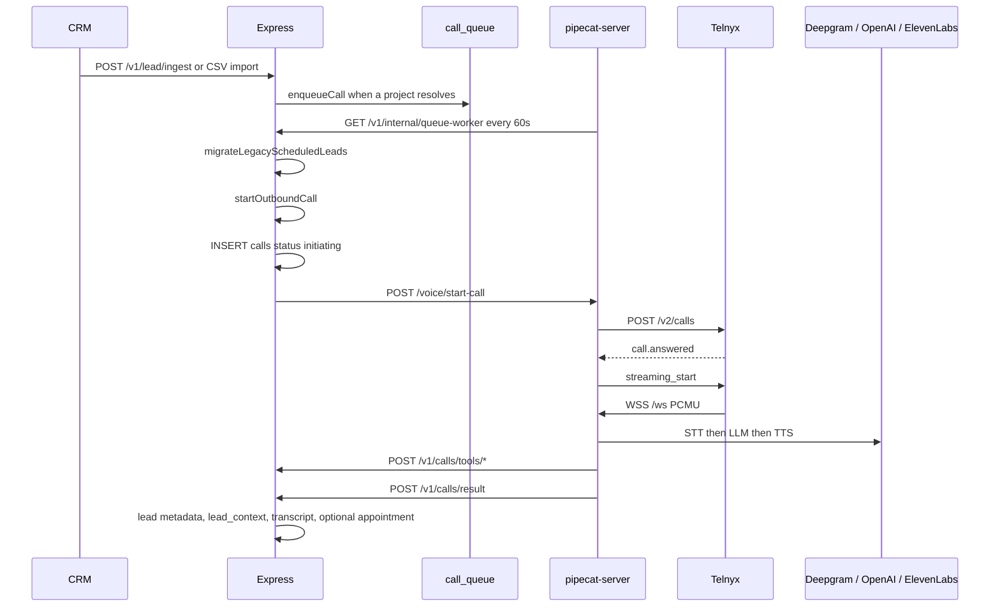

# Voice pipeline audit

**No calls were placed during this audit.**

## Lifecycle that the code implements

| Step | Function | File |
|---|---|---|
| Insert queue row | `enqueueCall` | `backend/services/callQueueService.js` |
| Also insert from ingest | `POST /lead/ingest` | `backend/routes/leads.js` |
| Also insert from webhooks | `processWebhookPayload` | `backend/integrations/webhookHandler.js` |
| Re-insert legacy leads | `migrateLegacyScheduledLeads` | `backend/routes/internal.js` |
| Pick work | `runQueueWorker` | same |
| Daily cap helper | `canAttemptLead` | `callQueueService.js` |
| Dial | `startOutboundCall` | `backend/services/startOutboundCall.js` |
| Telnyx | `_make_telnyx_call` | `pipecat-server/server.py` |
| Media and model | `bot` | `pipecat-server/bot.py` |
| Persist result | `POST /calls/result` | `backend/routes/newCalls.js` |

## Queue states the code writes

There is no CHECK constraint on `call_queue.status`. Writers use:

`queued` → `processing` (inside the lock) → `calling` (after the VM accepts) or `failed` or `retry_scheduled` or `max_attempts_reached`.

`getQueuedCalls` only selects `queued` and `retry_scheduled` whose `scheduled_at <= now()`.

`canAttemptLead` counts rows for the lead where `last_attempt_at` is today and status is not `queued`, `cancelled`, or `retry_scheduled`. Cap is `MAX_ATTEMPTS_PER_DAY = 2`.

`updateQueueStatus` sets `last_attempt_at` only when the new status is `calling` or `processing`. The worker's own lock update sets `processing` with a raw `UPDATE` that does **not** set `last_attempt_at`. A later update to `failed` also does not set it.

## Polling

- VM: `_queue_poller` sleeps 60 seconds, then GET queue-worker and GET process-reminders. Auth header is `CRON_SECRET` or `VOICE_SECRET`.
- Worker capacity: `MAX_CONCURRENT_CALLS` default 3 in Node, default 4 in Python. They are separate env vars.
- Vercel cron in `backend/vercel.json` is daily, not minutely. It is not the clock that created the failure volume.
- Locking: `SELECT ... FOR UPDATE SKIP LOCKED` on the queue row, then status `processing`, then commit, then dial outside the transaction.

## Provider ids

Telnyx `call_control_id` is kept in the VM dict `_pending_calls` and in the websocket query body. It is **not** written to `calls`. After a restart the VM cannot correlate a webhook to a CRM call except by what is still in memory. `calls.id` is a UUID generated in `startOutboundCall` and sent as `call_id`.

## What the database shows

| Status | calls | call_queue |
|---|---|---|
| failed | 118,255 | 118,239 |
| completed | 11, last on 7 June 2026 | — |
| initiating | 1 | — |
| retry_scheduled | — | 2 |

118,240 failed calls have `error_message = HTTP 502`. Queue `failure_reason` is `Voice service error`. FastAPI raises `HTTPException(502, detail=...)`. Express reads `body.error`, which FastAPI does not set, so the Telnyx text is discarded. The table cannot prove whether Telnyx was contacted.

From 27 October through 8 November 2026 about 2,300–2,400 call rows were inserted per day. 9 November: 340. 10 November: 2.

## Exact source of the repeat

All three of these are true in the current source:

1. `startOutboundCall` sets `metadata.call_initiated = true` only after the VM returns HTTP 200. On failure it sets `ai_call_status` to `Failed` and leaves `call_initiated` false.
2. `migrateLegacyScheduledLeads` inserts a **new** `call_queue` row for every lead that still has `metadata.scheduled_call_at`, is not `not_interested` or `closed`, and has no queue row in `queued`, `retry_scheduled`, `processing`, or `calling`. A `failed` row does not block the insert.
3. `canAttemptLead` does not count those new rows, because `last_attempt_at` is still null when the attempt dies as `failed` before `calling`.

So each minute the poller creates another queue row, `startOutboundCall` inserts another `calls` row, the VM returns 502, and the lead stays eligible.

`scheduleRetry` (30 minutes) runs only when the error string matches `ECONNREFUSED`, `timeout`, `fetch failed`, `ETIMEDOUT`, or `Voice service timeout`. The message stored for this incident is `Voice service error`, which is the non-retriable branch. The storm is not that retry helper. It is the legacy migrator plus a failure that does not stick.

## Consent, opt-out, transfer

- No consent column and no check before `enqueueCall` or `startOutboundCall`.
- No opt-out or DNC flag.
- `human_handoff` on `lead_context` is a score flag. `LeadConversionPanel.tsx` displays it. There is no Telnyx transfer, no whisper, and no live-listen socket.
- Answering-machine detection is disabled in `_make_telnyx_call`.

## Safest remediation

Do this in order. Do not turn Telnyx acceptance on first.

1. Stop `_queue_poller` on the VM, or make `runQueueWorker` return immediately when an env kill switch is set. That stops new rows without a schema change.
2. Change `migrateLegacyScheduledLeads` so a lead is skipped when **any** `call_queue` row exists for that lead in a non-cancelled status, including `failed`. Better: stop calling the migrator once `call_queue` is the only scheduler. `callScheduler.js` is already off the boot path.
3. In `updateQueueStatus` and in the failure branch of `runQueueWorker`, set `last_attempt_at = now()` for `failed`.
4. In `startOutboundCall`'s `markCallFailed`, set `metadata.call_initiated` true or clear `scheduled_call_at`, so step 2 has a second brake.
5. Make `canAttemptLead` count `calls` rows for that lead since midnight, not only queue rows with `last_attempt_at`.
6. Only after that is deployed, archive the 118k failed rows. Do not delete them before a backup. They are evidence and they make `GET /v1/calls/:tenantId/summary` count a huge set.
7. Persist `call_control_id` on `calls` in a later change so a webhook can be reconciled. That is not required to stop the loop.

Do not add a second queue table. Do not replace Pipecat to fix this.
